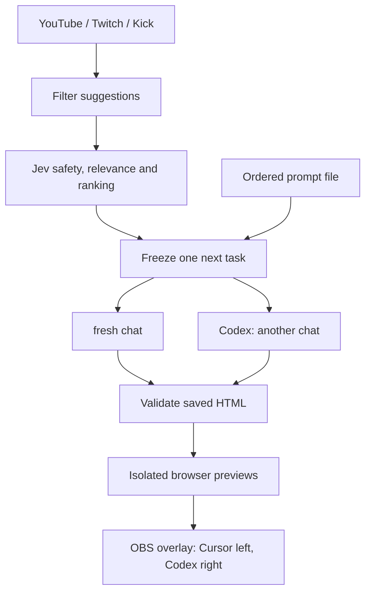
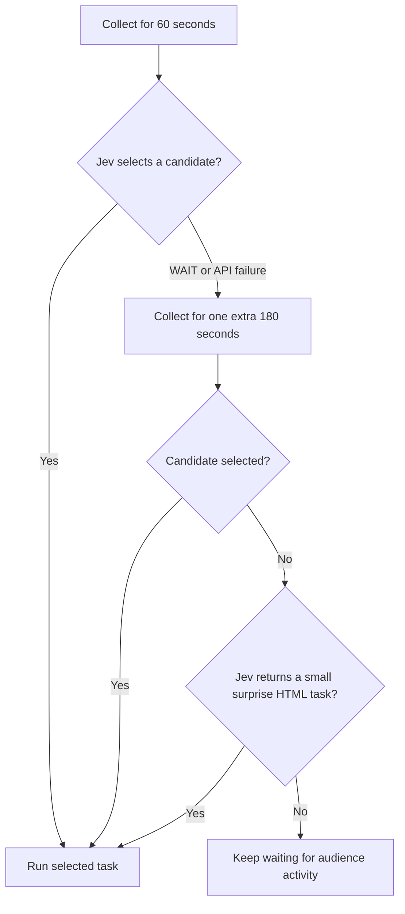
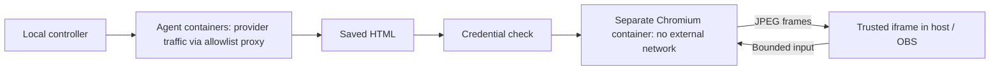

# Twitching

A local Codex vs Cursor show: audience suggestions go through a blocked-word list and TypeSafe Jev; both agents get the same task in fresh chats. Cursor is on the left and Codex on the right. The app starts paused in **private rehearsal** mode.

## Start locally

Copy `.env.example` to `.env.local` and fill in your own credentials privately. 
Add your own `assets/break.mp3` for break music. 
The blocked-bad word filter starts empty; configure it before accepting public chat. 
Jev safety checks remain enabled.

### Meet the CLIs
```tex
+-----------------------------+-----------------------------+ with Quota monitoring and separate login
| Cursor CLI                  | Codex CLI                   |
|                             |                             |
|                             vs                            | 
|                             |                             |
|                             |                             |
+-----------------------------+-----------------------------+

Solo mode: choose either CLI for a full-width show.
```
Current runners support **Codex and Cursor**.

## Contents
- [Quick start](#quick-start)
- [How the show works](#how-the-show-works)
- [Startup options](#startup-options)
- [Configuration and credentials](#configuration-and-credentials)
- [Connect the platforms](#connect-the-platforms)
- [Rehearse and go live](#rehearse-and-go-live)
- [Round rules](#round-rules)
- [Isolation and privacy](#isolation-and-privacy)
- [Verification](#verification)
- [Project layout](#project-layout)
- [Official references](#official-references)

## Quick start

### 1. Prepare your machine

- [ ] Install **Node.js 24+** and open **Docker Desktop**. Docker is also required for native-agent previews.
- [ ] Run `npm ci`.
- [ ] Copy `.env.example` to `.env.local`; fill in credentials privately.
- [ ] Supply your own `assets/break.mp3`; audio is not distributed.
- [ ] Add blocked words in `settings.json`.

Agent logins and private settings are local only; the repository does not include them.

### 2. Use guided startup

```sh
./check_stream_start.sh
./start_stream.sh
```

- **Check:** defaults to live readiness; starts no broadcast or coding job.
- **Start:** asks for private/live mode and Docker/native agents, checks readiness, then starts or safely reuses a paused app.
- **First run:** choose private rehearsal and Docker. Public mode requires a recorded rehearsal confirmation.

Keep the terminal open. **Ctrl+C ends the activated show and broadcast.**

### 3. Open the control desk and overlay

**Run the show:** open the [host control panel](http://127.0.0.1:3210/control).

**Display the show:** add the [overlay](http://127.0.0.1:3210/overlay) as an OBS Browser Source at **1920 × 1080**.

Use these exact `127.0.0.1` addresses; other Host headers are rejected. Refresh reconnects to the current show and recent events.

### Manual setup alternative

After opening Docker Desktop, run the remaining setup commands. Image setup can take a few minutes.

```sh
npm run sandbox:build
npm run sandbox:build:preview
docker compose -f sandbox/compose.yml up -d
docker network create --internal stram_previews
npm run sandbox:login:codex
npm run sandbox:login:cursor
npm run build
npm run dev
```

Sign in yourself using your existing subscriptions. Docker login commands save authentication under ignored `runtime/auth/`; never paste CLI credentials into prompts. Personal terminal chats are left alone.

To override the Codex image's CLI version at build time:

```sh
docker build --build-arg CODEX_VERSION=YOUR_INSTALLED_VERSION -t prompt-arena-agent:local sandbox
```

## How the show works

### From suggestion to result



Each round uses new sessions without a resume flag. In single-agent mode, only the selected CLI runs, with one full-width preview and activity panel.

### Task sources

**Audience chat** → collect suggestions → filter and rank → freeze one next task.

**Prompt file** → read `prompts.txt` or `settings.promptFile` → send each line to both agents in order.

Use `--prompts` to force the file, or `--no-prompts` to keep chat even when the file has tasks.

With a prompt list, the next task starts after the result hold. After the last task, the show ends and the desk offers chat collection or ending the stream.

**Stop** opens **Chat** and **End**. Each offers **After this round** or **Now**; Chat also asks which platforms to use.

## Startup options

### Common commands

| Goal | Command |
| --- | --- |
| Private rehearsal | `./start_stream.sh --mode rehearsal --runner docker` |
| Live show | `./start_stream.sh --mode live --runner docker` |
| Codex only | `./start_stream.sh --codex` |
| Cursor only | `./start_stream.sh --cursor` |
| Explicit CLI selection | `./start_stream.sh --cli cursor` |
| Codex rehearsal readiness | `./check_stream_start.sh --cli codex --mode rehearsal` |
| Rehearsal readiness | `./check_stream_start.sh --mode rehearsal` |
| Live readiness + verification | `./check_stream_start.sh --mode live --verify` |
| Non-interactive live readiness | `./check_stream_start.sh --mode live --non-interactive` |
| Live chat, skipping YouTube and Twitch | `./start_stream.sh --mode live --no-prompts --skip yt --skip twitch` |
| Optional native agents | `./start_stream.sh --mode live --runner native` |

No CLI selection flag means **both agents**. Rebuild the frontend with `npm run build` after UI code changes. Use `--help` for all options.

### What readiness checks mean

- **Local requirements:** Docker, images, networks, saved CLI logins and exact requested models
- **Show services:** Codex quota, Jev, required private field names and media files
- **Preview:** Temporary isolated HTML preview
- **OBS:** Overlay Browser Source configuration
- **Live readiness:** Recorded rehearsal confirmation using the same Docker/native runner mode
- **Platform permissions and signed Kick delivery:** Marked pending until verified against live platforms

Failures print specific fixes. Interactive checks offer image builds, network setup or CLI login; missing dependencies can be installed after a shell prompt.

`--verify` runs type checks, tests, fixture replay and the frontend build. Docker-agent mode also runs the real agent boundary test. Without it, tests run only if you accept the check script's prompt.

### Startup and broadcast safeguards

- Mode overrides use `ARENA_MODE` / `ARENA_RUNNER` for that process; `settings.json` is not rewritten.
- An existing app with different/stale settings or active work is refused, with pause/stop/restart instructions.
- Going public requires scene, audio and webhook confirmation, then a final **yes**.
- If the script starts a public broadcast but controller startup fails, it stops that broadcast.
- Failed prerequisite checks do not stop a pre-existing broadcast.
- OBS checks confirm source configuration. Rehearsal must confirm visibility and audible audio.

### Native agents: explicit opt-in

> Native agents can read and change host files outside this project. Docker remains the default execution boundary; there is no automatic native fallback.

- **Consent:** Type `NATIVE` through `start_stream.sh`
- **Lifetime:** `ARENA_NATIVE_APPROVED` applies only to the launched app process; never saved in settings
- **Direct app start:** Cannot launch native coding jobs without confirmation
- **Codex login:** Private arena login
- **Cursor login:** Native subscription login; CLI must expose `--sandbox`
- **Models:** Exact requested models remain mandatory
- **Previews:** Still require Docker
- **Cancellation/restart:** Process groups and ownership records
- **Limitation:** Process groups do not isolate files; escaped/background work may need manual cleanup

## Configuration and credentials

### Files and responsibilities

- **`.env.local`:** Credentials; Private, Git-ignored; runtime permissions set to `0600`
- **`settings.json`:** Timings, model IDs, blocked words, Jev startup probe, media paths and Kick webhook URL; Public configuration; restart after edits
- **`runtime/auth/`:** Saved CLI authentication; Private, Git-ignored
- **`assets/break.mp3`:** Your break music; Supply locally

Credentials are never requested or printed in the terminal. Edit `.env.local` privately; it is neither served to browsers nor mounted into coding containers. Agent instructions forbid reading it.

**Limit:** file permissions cannot exclude an assistant running as the same OS user. Credentials stay outside app-facing and container-facing surfaces, but the assistant must also obey the no-read rule.

### Exact model selection

The configured Cursor ID is an **unverified requested ID**. It does not prove Grok 4.7 high is available to your account.

Startup requires that exact ID in `cursor-agent --list-models`, with a label identifying Grok 4.7 high. Missing model or effort support pauses the show; no replacement model is used.

Codex-only mode retains quota monitoring. Cursor-only mode reports usage failures through its CLI and needs no Codex login. Only the selected CLI is checked and launched; the rest of the show flow stays available.

## Connect the platforms

### Required access

| Platform | Credentials and setup | Chat delivery |
| --- | --- | --- |
| YouTube | Enable YouTube Data API; OAuth access token with `youtube.readonly`; live chat ID; optional refresh token/client credentials | Official server-streaming gRPC with continuation tokens |
| Twitch | User access token with `user:read:chat`, client ID, bot user ID, broadcaster ID; refresh credentials for expiry | EventSub `channel.chat.message` |
| Kick | Developer app with webhook enabled; token with `events:subscribe`; broadcaster user ID | Signed HTTPS webhook to `/kick` on port **3212** |

### Platform-specific details

**YouTube**

- If enabled with an empty `YOUTUBE_LIVE_CHAT_ID`, startup looks up an active or upcoming livestream using your access token.
- Sponsor metadata and recent official gift events establish bonus eligibility; viewer claims do not.
- The protobuf file includes only consumed wire fields, using Google's field numbers.

**Twitch**

- Handles keepalives/reconnects and recreates subscriptions after a dropped connection.
- Messages missed during disconnection are not replayed.
- Empty Twitch fields skip Twitch.

**Kick**

- Register an HTTPS endpoint forwarding **only port 3212** to `/kick`.
- Put the same URL in `kickWebhookUrl`. This local setting does not register the remote webhook; configure it in the Kick developer app too.
- Do not tunnel ports **3210, 3211 or 3213**.
- The listener checks the RSA signature over exact bytes, timestamp, event version and broadcaster; duplicate events are ignored.
- A signed subscriber badge or gift event establishes bonus eligibility.

### Failures, refresh and skipped platforms

- **Skip a platform:** Use `--skip yt`, `--skip twitch` or `--skip kick` in live mode
- **Platform error:** Appears in the host desk; pauses new rounds
- **Platform token refreshed:** Kept in memory during the show
- **Provider rotates refresh token:** Update local credentials before restarting
- **CLI subscription refresh:** Retained in private auth directories

## Rehearse and go live

### Private rehearsal checklist

1. Keep `mode: "rehearsal"`. Enable **OBS WebSocket v5** under **Tools → WebSocket Server Settings**; put its password in `.env.local`.
2. Press **Start** to check CLI logins, exact models, quota, isolated previews, music and visuals.
3. If Jev is configured, submit a private suggestion; otherwise choose **Prepare house task**. Both real CLIs receive the same task; activity is real agent output.
4. Record privately in OBS and complete the checks below.
5. After both pages succeed and OBS is checked, press **I checked the private OBS rehearsal**. This records your confirmation; automated tests cannot confirm a real rehearsal.

- [ ] Shared timers work; the faster result appears while the other agent is working.
- [ ] Both finished previews display correctly.
- [ ] Pause, Resume, Skip and Stop work.
- [ ] Refresh reconnects to the show.
- [ ] Browser Source audio is audible. Autoplay may need OBS configuration or **Play music**.

### Go public

Use `start_stream.sh` and choose live mode. Alternatively, set `mode: "live"`, restart, start OBS streaming manually, then press **Start**.

The script can start OBS after confirmation; the controller itself does not start broadcasts. Platform startup is checked before collection. Verify signed Kick delivery with a real message.

### Stop safely

- ****Stop show + OBS**:** Stops runners, confirms container shutdown and sends OBS `StopStream`
- **Stop streaming in OBS:** Also stops the app's show
- **OBS stop fails:** App reports unconfirmed shutdown; check OBS yourself

## Round rules

### 1. Admit suggestions

- **Prefix:** Strip `!prompt`
- **Length:** At least five words
- **Readability:** At least **80%** recognized English, common technical terms or numbers
- **Unknown words:** A few names or typos allowed; no special Hinglish/romanized-speech support
- **Repetition:** Reject when one word is **60% or more** of the suggestion
- **Abuse and spam:** Reject duplicates, blocked abuse, unreadable text and emoji-only content
- **Split blocked words:** Check fragments together, such as `fuc k` and `chu tiya`
- **Replacement:** A new valid submission replaces that viewer's earlier suggestion, including pending evaluation

The blocked-word filter runs before Jev's separate safety and HTML relevance gates. Once the next task is frozen, later submissions wait for the next collection window.

### 2. Rank and choose

Keep the strongest **30 candidates**.

| Score component | Weight |
| --- | ---: |
| Simplicity | 40% |
| Clarity | 25% |
| Creativity | 20% |
| Visual appeal | 15% |
| Verified YouTube/Kick membership or gifts | Up to +10 points |

A weak or unsafe paid suggestion stays rejected.



### 3. Run and validate

Both runners are prepared before their start commands are issued together. Provider startup latency can differ; both elapsed timers use the controller's launch timestamp.

Work ends on completion, a usage/authentication failure, or host Skip/Stop. Only these output files are saved:

```text
main/
├── codex/prompt_N.html
└── cursor/prompt_N.html
```

A successful result must pass every step:

1. CLI exits successfully.
2. Containers stop.
3. Output is a regular HTML file.
4. Page has visible content and no JavaScript loading error.

> Timeouts and cancellations stay **unfinished**, even if a partial file exists. Results remain visible for **30 seconds** after both attempts settle.

### 4. Pause, continue or restart

- **Pause:** Prevents new rounds; current work finishes
- **Private rehearsal:** One round, then pause; prompt lists are the exception
- **Prompt list:** Continue after each result hold; end after the final task
- **App restart:** Start paused, recover labelled containers; never relaunch a persisted job

### 5. Handle Codex quota

Quota comes from official app-server `account/rateLimits/read`, using its reported **300-minute window**.

- **Missing usage data:** Pause instead of guessing
- **Zero quota:** Play the configured MP3 and pixel-eye visual for up to ten minutes
- **Verified recovery:** Resume unless the host paused the show
- **No recovery within the break:** End the show and stop OBS
- **Future reset time reported:** Display it; do not treat it as proof of recovery

## Isolation and privacy

### Execution and preview boundaries



This diagram shows the default Docker mode. Native mode gives agent commands host filesystem access.

### Agent containers

- **User and filesystem:** Non-root; read-only root filesystem
- **Persistent writes:** One agent workspace mount
- **Host access:** No Docker socket; removed capabilities; resource limits
- **Authentication:** That agent's saved subscription copied into its private workspace
- **Network:** Internal network + HTTPS allowlist proxy for provider traffic
- **CLI bypass flags:** Apply inside the Docker boundary; do not grant host access
- **Proxy incompatibility:** Startup fails; never switches to native automatically

Arena Codex sessions use fresh `HOME` and `CODEX_HOME` folders with only the project's private Codex login. Personal configuration, skills, plugins, hooks and rules are not copied.

Apps/plugins/hooks and automatic `AGENTS.md` loading are disabled; built-in coding tools remain available. Startup requires CLI configuration/rule isolation flags and pauses if the effective configuration exposes extra integrations.

Native Codex uses the same arena profile rules: sign in with `npm run sandbox:login:codex`, rather than relying on your personal CLI profile. Normal Codex sessions and connected services stay unchanged. Profile isolation does not remove native mode's host filesystem access.

### Generated-page previews

- **Browser:** Separate Chromium container, internal network, no egress proxy, external DNS disabled
- **Controller connection:** Localhost relay over Docker exec streams; no published container port or host network exposed to Playwright
- **Page loading:** Initial HTML fulfilled from memory without rewriting; all other requests aborted; CSP adds another layer
- **Credential screening:** Refuse pages containing known credentials or recognizable credential tokens before rendering; saved HTML unchanged
- **Ordinary variable names:** `secret` and `password` alone do not cause rewriting or rejection
- **Host/OBS:** Generated JavaScript stays in isolated Chromium; trusted sandboxed iframe displays JPEG frames
- **Interaction:** Bounded click, hover, key and wheel input forwarded to the isolated page
- **Trade-off:** Roughly **5 frames/second**; no generated-page audio

The relay supports Docker versions that do not publish ports on internal networks. Saved HTML remains the actual agent output.

### Public activity and stored data

- **Published activity:** Assistant messages/public summaries, command/tool names, file basenames and output counts
- **Private activity:** Tool argument bodies, file-read results, full command output and raw stderr
- **Redaction:** Known credentials, token-shaped strings and private home paths
- **Partial messages:** Assembled before redaction; published at message/tool boundaries to prevent fragment leaks
- **SQLite:** Eligible candidates, evaluation cache, decisions, rounds and sanitized event history
- **Browser refresh:** Snapshot plus the most recent **160 events**

## Verification

### Commands

```sh
npm run check
npm test
npm run build
npm run replay
```

After Docker images and networks exist, check the real agent boundary without subscriptions or platform secrets:

```sh
STRAM_SANDBOX_TEST=1 npx tsx --test tests/sandbox.test.ts
```

### Coverage and limits

- **Suggestions:** Filtering, metadata bonuses, cache/replacement
- **Events:** Partial JSON, duplicate events, WebSocket reconnect
- **Selection:** WAIT, extension and continued collection
- **Rounds:** Paired timestamps, host cancellation, faster previews, usage interruption and restart
- **Controls and output:** Protected controls, rendering/input, unsafe or missing outputs

- Replay fixtures are representative documentation-shaped samples, **not recordings from live accounts**.
- The Docker test is skipped by default until the daemon and images exist.
- Before public automation, run a real private OBS rehearsal and collect real event recordings.

## Project layout

```text
server/       Controller, adapters, database, runners and isolated previews
shared/       Shared event and state types
web/          React overlay and host desk
sandbox/      Containers and network policy
tests/        Focused acceptance checks
main/         Generated HTML examples and round output
assets/       Provider images in chatgpt/, codex/, grok/ and cursor/
```

See [`initial_plan.md`](initial_plan.md) for the original project brief.

## Official references

- **Jev:** [Introduction](https://docs.typesafe.ai/introduction) · [Coding-agent boundary](https://docs.typesafe.ai/introduction/coding-agents)
- **Codex:** [Exec JSON](https://learn.chatgpt.com/docs/non-interactive-mode) · [Models and quota protocol](https://learn.chatgpt.com/docs/app-server)
- **Cursor:** [CLI output format](https://cursor.com/docs/cli/reference/output-format)
- **YouTube:** [Streaming live chat](https://developers.google.com/youtube/v3/live/streaming-live-chat)
- **Twitch:** [EventSub chat](https://dev.twitch.tv/docs/chat/send-receive-messages/)
- **Kick:** [Event types](https://github.com/KickEngineering/KickDevDocs/blob/main/events/event-types.md)
- **Playwright:** [Docker](https://playwright.dev/docs/docker)
