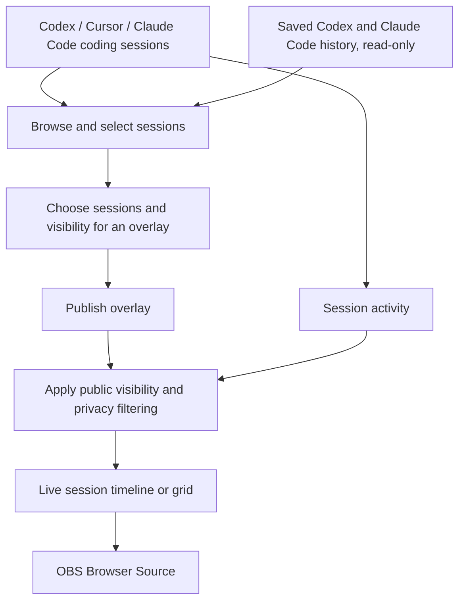
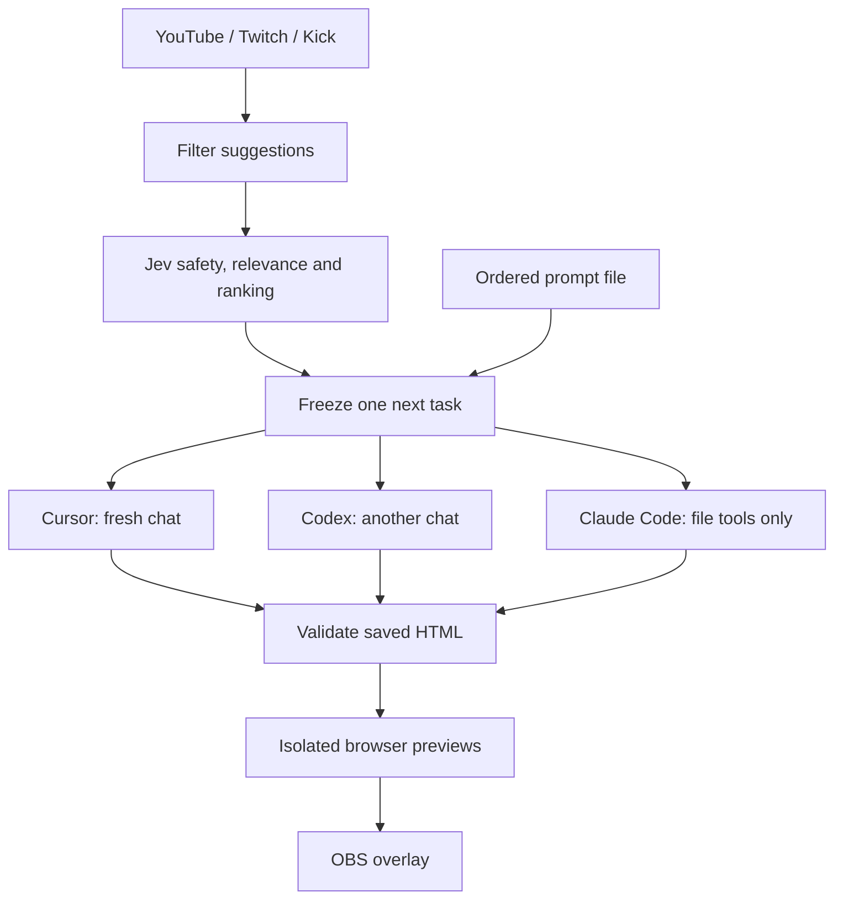
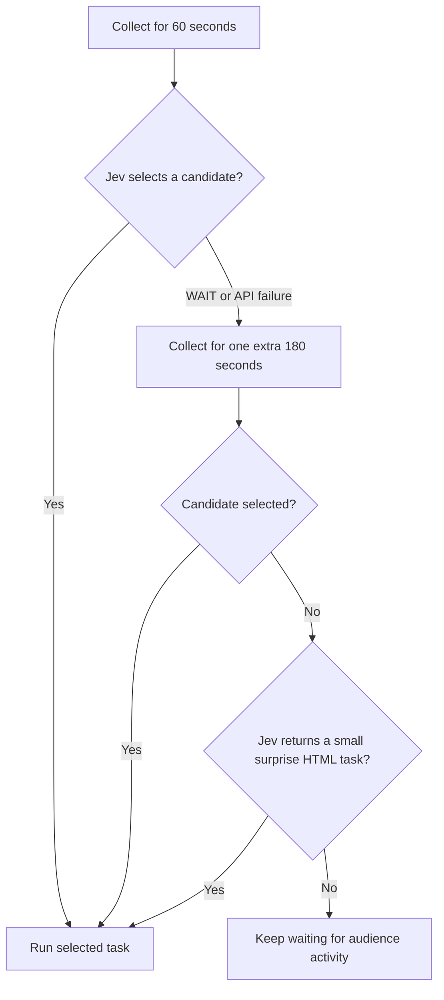
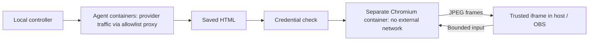
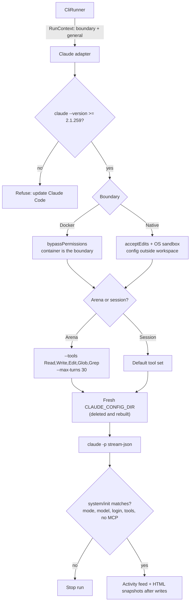

# Twitching👀

> **Taglines:**
> 1. Share **live coding sessions for Twitch**: show your coding CLI without sharing your computer screen.
> 2.  Twitch viewers are **prompters**: every qualifying `!prompt` from **Twitch, YouTube or Kick chat**.
> 3. **Twitch chat** writes the task; **LLM coding agents** build it **live** inside **sandboxed containers**.
> 4. An **agent-vs-agent game show**: build it, compare it and let viewers be the judges.

<p align="center">
  
</p>
<p align="right">
   <a href="assets/break-visual.html">assets/break-visual.html</a> 
</p>

Share what a coding CLI such as Codex or Claude Code is doing without sharing your screen.

- Show multiple Codex and Claude Code sessions in one screen
- See chats from multiple platforms on one page (youtube , twitch , kick) .
- select what to show (tools use , file name , commands , edits, model name, etc..)
- use it with OBS (Browser source)
- viewers can prompt to harness from comment box and jev will filter. when viewer comment with "!prompt".
- Run agents in a Docker sandbox.
- TypeSafe Jev filters prompts and chats according to your preferences.
- Play music and visuals when the Codex account quota runs out.
- assign goal timer .
- Prompt arena: vs between models and harness. 
- supports twitch, yt , kick. harness :Codex, Cursor and Claude Code.
- add breaks between live_streams .
- show chats from multiple platforms using OBS Browser source 

Developed with the help of Codex. Started for the [TwitchCon Codex hackathon](https://twitchcon-codex.devpost.com/).

### SESSION MODE OVERLAY

Session Mode turn : coding session into full OBS Browser scene. Its timeline shows the session title, CLI/model, and cli activities.

```text
+------------------------------------------------------------------+
|  CLI · Session title                                    Model    |
+------------------------------------------------------------------+
| Prompt                                                           |
| ----------                                                       |
| reponse:                                                         |
|                                                                  |
| Assistant message                                                |
| annotations                                                      |
| file edits/reads                                                 |
| Tool activity                                                    |
| activity summary ....                                            |
| mermaid & tables                                                 |
|                                                                  |
+------------------------------------------------------------------+
```

### PROMPT ARENA OVERLAY
```tex
+---------------with Quota monitoring-------------------------+ 
|                             |                             |
|                             |                             |
| Cursor CLI                  |    Codex CLI                |
|                             |                             |
|                             |                             |          
|                             |                             |
|                             |                             |
+-----------------------------+-----------------------------+

Any two of Cursor, Codex and Claude Code can face off.
Solo mode: use one harness and choose your models.
```
Current runners support **Codex, Cursor and Claude Code**.

## Contents
- [Quick start](#quick-start)
- [How the show works](#how-the-show-works)
- [Startup options](#startup-options)
- [Chat feed, filters and simulation](#chat-feed-filters-and-simulation)
- [Configuration and credentials](#configuration-and-credentials)
- [Connect the platforms](#connect-the-platforms)
- [Rehearse and go live](#rehearse-and-go-live)
- [Round rules](#round-rules)
- [Isolation and privacy](#isolation-and-privacy)
- [Verification](#verification)
- [Project layout](#project-layout)
- [Contributing](#contributing)
- [Official references](#official-references)

## Quick start

Clone the repository and enter its directory:

```sh
git clone https://github.com/mayank-devac/Twitching.git
cd Twitching
```

### 1. Run setup (once)

```sh
./setup.sh            # asks before each change; ./setup.sh --yes accepts them all
```

`setup.sh` works on macOS and Linux (Windows: inside WSL2), and is safe to rerun. Each step checks first and only fixes what is missing:

1. **Node.js 24+.** On macOS it offers `brew install node`.
2. **App dependencies** (`npm ci`).
3. **Local files.** Creates `.env.local` from `.env.example` and an empty `prompts.txt`. Existing files are never opened or overwritten.
4. **Docker engine.** Uses Docker Desktop or Colima if one is running. Otherwise it starts Colima, or on macOS offers `brew install colima docker docker-compose docker-buildx`. A new Colima VM gets 4 CPUs, 6 GB RAM and a 20 GB disk.
5. **Sandbox images, egress proxy, preview network.** Also checks that Docker can see this folder.
6. **Coding CLI logins.** Optional: Codex, Claude Code, Cursor. At least one is needed for the arena.
7. **Terminal commands.** Adds them to `~/.zshrc`, or for bash to `~/.bash_profile` (macOS) / `~/.bashrc` (Linux).

Optional extras: fill in `.env.local` only for the chat platforms, Jev and OBS password you use; add your own `assets/break.mp3` (audio is not distributed); add blocked words in `settings.json`. Agent logins and private settings stay local; the repository does not include them.

**Something wrong?** Run `./doctor.sh` (or `twitching_doctor`). It changes nothing, checks every item above plus ports and OBS, and prints a fix for each problem. The report hides your home path and never reads credentials, so you can paste it into a [GitHub issue](https://github.com/mayank-devac/Twitching/issues). `./doctor.sh --save report.txt` also writes it to a file.

### 2. Use guided startup

`setup.sh` already installs the terminal commands. To (re)install only them, for example after moving the clone:

```sh
./install_start_stream.sh
source ~/.zshrc       # bash: source ~/.bash_profile (macOS) or ~/.bashrc (Linux), or open a new terminal
```

```sh
start_sessions
```

This installs these commands (plus `twitching_doctor` for diagnostics):

| Command | Opens | Flags |
| --- | --- | --- |
| `start_sessions` (run this first) | **Session mode controls**: the welcome page for coding sessions | `--chats` only |
| `start_stream` | Old behaviour: no flags opens the welcome page, any flag runs the guided arena | All |
| `start_arena` | **Prompt arena controls**: the guided arena startup (rehearsal/live, Docker/native, sessions, checks), even with no flags | Same flags as `./start_stream.sh` |


```sh
start_sessions                     # session mode , choose this to show codex , claude chats in obs browser source 
start_arena                        # prompt arena requires you will need docker / colima with sandbox login (under construstion)
start_arena --mode rehearsal --codex
```
> sessions to share coding cli sessions and Prompt arena for fun autmoated runs .

Without the installer, run the files directly: `./start_arena.sh` and `./start_sessions.sh`.

If Docker is not reachable and Colima is installed, each command starts Colima and uses its isolated Docker socket automatically. The installer only adds a marked block of functions to your shell file; it does not copy credentials. Rerunning it replaces an older block, or one that points at a moved or deleted clone, and keeps a backup next to the file (`*.twitching-backup`). If the clone moves later, the commands say so and tell you to rerun the installer.

**OBS is optional at startup.** If OBS is closed or the overlay Browser Source is missing, the launcher prints a `WARNING` with the setup steps and continues. You can open OBS later. A **live** broadcast still needs OBS running when you confirm the public start.

With **Docker Desktop insalled**
```sh
./check_stream_start.sh
./start_stream.sh
```
or 

**with Colima — terminal only, no Docker Desktop:**

```sh
brew install colima docker docker-compose docker-buildx
./with_colima.sh ./check_stream_start.sh --mode rehearsal
./with_colima.sh
```

`with_colima.sh` starts Colima if needed and uses an isolated Docker configuration under ignored `runtime/docker-cli/`. Existing Docker registry logins and Desktop settings are left untouched. With no arguments, it opens guided private rehearsal; pass a command to run it with the same Colima settings.

To use your Mac's installed Codex CLI and saved login, with Colima only for previews:

```sh
./with_colima.sh ./start_stream.sh --mode rehearsal --runner native --codex
```

The launcher requires `NATIVE` confirmation because agent commands can access host files. The app seeds its private arena profile from your saved Codex login when available; personal settings and plugins are not copied.

When `setup.sh` or `with_colima.sh` creates a new Colima VM, it uses **4 CPUs, 6 GB RAM and a 20 GB disk**. An existing VM keeps its size; `./doctor.sh` warns below 5 GB RAM. Container images still consume disk space. Use `colima stop` after stopping the show to release VM memory.

**Docker must see the project folder.** Colima and Docker Desktop run containers in a VM that only sees shared Mac folders. Startup checks this (**project folder shared with Docker**) before any agent runs. If it fails with Colima, the launcher offers to restart Colima with your home folder (and the project, if it is cloned outside home) shared. Manual fix:

```sh
colima stop
colima start --mount "$HOME:w"                 # add --mount "/path/to/Twitching:w" if cloned outside $HOME
```

With Docker Desktop, add the folder under **Settings → Resources → File sharing**. The old symptom was `bind source path does not exist: …/runtime/workspaces/…`.

**Docker Desktop — open it first:**

```sh
./check_stream_start.sh
./start_stream.sh
```

- **Check:** defaults to live readiness; starts no broadcast or coding job.
- **Start without flags:** opens the idle welcome UI. **Start with flags:** keeps the guided arena readiness and launch flow.
- **`./start_arena.sh`** always runs the guided arena flow; **`./start_sessions.sh`** always opens session mode.
- **First run:** choose private rehearsal and Docker. Public mode requires a recorded rehearsal confirmation.

Keep the terminal open. **Ctrl+C ends the activated show and broadcast.**

### 3. Open the control desk and overlay

**Run the show:** open the [host control panel](http://127.0.0.1:3210/control).

**Quick Settings:** use the control panel's **Quick Settings ↗** link to open a separate host tab at `/control/settings`. New chat-source defaults are unchecked. Saved source choices and explicit startup choices remain meaningful; guided startup enables sources only with repeated `--chat yt`, `--chat twitch` or `--chat kick` flags (or later through Settings). Break visuals can fit the whole image, show it centered at original size, or fill the screen and crop edges.


Focused verification (run manually):

```sh
npm run check &&
npx tsx --test tests/quick-settings.test.ts tests/controller.test.ts tests/startup-config.test.ts tests/http.test.ts &&
npm run build
```

Then exercise two settings tabs in private rehearsal: stale save rejection, two same-CLI cards, a pending model change during a round, stale prepared-prompt editing, a scheduled/immediate or untimed break, reload during a break, Start/Resume with exhausted quota, drag-and-drop uploads, full-screen GIF display, unsaved-navigation warnings, uploaded/missing media, and blocked audio. Verify actual OBS shutdown separately in a deliberately started test broadcast; unit fixtures cannot prove OBS or installed CLI integration.


**Display the show:** add the [overlay](http://127.0.0.1:3210/overlay) as an OBS Browser Source at **1920 × 1080**.

Use these exact `127.0.0.1` addresses; other Host headers are rejected. Refresh reconnects to the current show and recent events.

### Manual setup alternative

With Colima installed, run the remaining setup commands below. Image downloads can take time. Docker Desktop users can omit the `./with_colima.sh` prefix.

```sh
./with_colima.sh npm run sandbox:build
./with_colima.sh npm run sandbox:build:preview
./with_colima.sh docker compose -f sandbox/compose.yml up -d
./with_colima.sh docker network create --internal stram_previews
./with_colima.sh npm run sandbox:login:codex
./with_colima.sh npm run sandbox:login:cursor
npm run sandbox:login:claude
npm run build
./with_colima.sh npm run dev
```

Sign in yourself using your existing subscriptions. Docker login commands save authentication under ignored `runtime/auth/`; never paste CLI credentials into prompts. Personal terminal chats are left alone.

**Reusing an existing login:** if `~/.codex/auth.json` exists, `npm run sandbox:login:codex` (and `./setup.sh`) asks whether to copy it into the sandbox or sign in to a new, separate sandbox login. Copying skips the sign-in, but both copies share one refresh token: when either side renews it, the other may be signed out. Runs never copy it on their own.

**Claude Code** is opt-in at `npm run sandbox:build` (`INSTALL_CLAUDE=1`), like Cursor. Your normal Claude sign-in lives in the macOS Keychain and expires within hours, so it is not copied. Instead, when the `claude` CLI is installed, `npm run sandbox:login:claude` offers to run `claude setup-token` for you (one browser click if you are already signed in; needs a Claude Pro, Max, Team or Enterprise plan); paste the token it prints. The input is hidden. The token is stored at `runtime/auth/claude/oauth-token` (mode 0600) and handed to each run through its environment, never written into a workspace. `ANTHROPIC_API_KEY` is never forwarded, because in print mode it would override the subscription token.

Claude runs use `claude --print --output-format stream-json` with:
- an empty, strict MCP config;
- `--setting-sources user`, which points at a managed `CLAUDE_CONFIG_DIR` that is deleted and rebuilt on every launch, so nothing an agent plants there (CLAUDE.md, skills, settings) survives to the next run;
- hooks disabled, no session persistence, and `--permission-prompts none` (a call that needs approval is denied, not retried);
- background tasks off (`CLAUDE_CODE_DISABLE_BACKGROUND_TASKS=1`);
- for arena rounds only: file tools only (`--tools Read,Write,Edit,Glob,Grep`, so no Bash, web or subagents) and `--max-turns 30`. Coding sessions keep the default tool set.

Claude Code **2.1.259 or later** is required; older versions are refused at startup. When the run starts, its `system/init` event is checked against what was requested. The run stops if the permission mode, model, login type (an API key instead of the saved token) or arena tool set doesn't match, or if any MCP server or plugin loaded. Blocked tool calls appear in the activity feed.

Your personal `~/.claude` settings, CLAUDE.md, skills, plugins and Keychain login are not used. In Docker the container is the boundary (`bypassPermissions`). Native runs use `acceptEdits` plus Claude's own OS sandbox for Bash (`failIfUnavailable`), and keep the config folder in `runtime/claude-config/<session>`, outside the working directory, so the agent cannot edit its own settings. The adapter builds the right profile for each boundary; the host never rewrites flags. Choose a model with `claudeModel` / `claudeEffort` in `settings.json` (default `sonnet` / `high`), or with `--session claude:opus:high`.

To override the Codex image's CLI version at build time:

```sh
docker build --build-arg CODEX_VERSION=YOUR_INSTALLED_VERSION -t prompt-arena-agent:local sandbox
```

## How the show works

### Session mode

Session Mode publishes existing coding sessions as live timelines, separately from the Prompt Arena round flow. Choose up to eight sessions for an overlay; one session fills the output, while multiple sessions share a grid.


---
### Prompt arena

agent vs agent 


Each round uses new sessions without a resume flag. In single-agent mode, only the selected CLI runs, with one full-width preview and activity panel.

### Task sources

**Audience chat** → collect suggestions → filter and rank → freeze one next task.

**Prompt file** → read `prompts.txt` or `settings.promptFile` → send each line to every session in order. Nothing runs by itself: edit the file at any time, then press **Check prompts** / **Send prompts** in the arena controls, or run `./start_stream.sh send` (re-reads the file), `./start_stream.sh send "my prompt" "another"` (only those) or `./start_stream.sh send --check` (list, send nothing). A send replaces any earlier list and runs after the current round.

Use `--prompts` to run the file automatically at startup, or `--no-prompts` to keep chat.

**Sessions** → Quick Settings sessions are kept between starts. Pass sessions only when you want to change them, e.g. `./start_stream.sh --codex-6-luna vs --codex-terra` (same as `--session codex:gpt-6-luna --session codex:terra`; names are matched against the CLI's model list). Sessions chosen with flags last for that run only: press **Save as default** in the arena controls to keep them. While unsaved, closing the browser tab shows a leave-page warning, and Ctrl+C in the terminal asks `Save this arena setup … as the default? [y/N]`.

**edit Jev prompts** →  `jev_prompts.json` in the repo root holds every sentence Jev works from: `evaluate.safety`, `evaluate.relevance`, `evaluate.scoreInstructions` (keep the `{dimension}` placeholder; the four rubric lists need exactly five grades) and `choose.instructions` with `choose.wait`, plus `surprise` for self-run rounds. Operator preferences from quick settings are appended automatically, and audience text stays data — edit only your wording, never the structure. A missing file falls back to built-in wording; a malformed file stops startup with a message naming the bad field. Restart after edits.

With a prompt list, the next task starts after the result hold. After the last task, the show ends and the desk offers chat collection or ending the stream.

**Stop** opens **Chat** and **End**. Each offers **After this round** or **Now**; Chat also asks which platforms to use.

## Startup options

### Common commands

| Goal | Command |
| --- | --- |
| Prompt arena controls (guided) | `./start_arena.sh` |
| Session mode controls | `./start_sessions.sh` |
| Session mode with OBS chat feeds | `./start_sessions.sh --chats` |
| Private rehearsal | `./start_stream.sh --mode rehearsal --runner docker` |
| Live show | `./start_stream.sh --mode live --runner docker` |
| Codex only | `./start_stream.sh --codex` |
| Cursor only | `./start_stream.sh --cursor` |
| Claude Code only | `./start_stream.sh --claude` |
| Claude Code rehearsal readiness | `./check_stream_start.sh --cli claude --mode rehearsal` |
| Explicit CLI selection | `./start_stream.sh --cli cursor` |
| Codex rehearsal readiness | `./check_stream_start.sh --cli codex --mode rehearsal` |
| Rehearsal readiness | `./check_stream_start.sh --mode rehearsal` |
| Live readiness + verification | `./check_stream_start.sh --mode live --verify` |
| Non-interactive live readiness | `./check_stream_start.sh --mode live --non-interactive` |
| Live chat, skipping YouTube and kick | `./start_stream.sh --mode live --no-prompts --skip yt --skip kick` |
| Start with OBS chat feeds enabled | `./start_stream.sh --chats` |
| Optional native agents | `./start_stream.sh --mode rehearsal --runner native` |
| Native live, prompt list only | `./start_stream.sh --mode live --runner native --prompts` |

### Chat feed, filters and simulation

The chat feed is separate from arena prompt collection. It can show incoming YouTube, Twitch and Kick comments on the host page or as an OBS Browser Source. It is off by default; when off, comments are not retained in the feed.

- Start with `./start_stream.sh --chats` to enable the feed at startup. The launcher prints the OBS URLs.
- In the welcome page, open **Chats → Chat history** to view comments and turn the feed on or off. Turning it off clears the in-memory history.
- Add `http://127.0.0.1:3210/chat` as an OBS Browser Source for all comments, or `http://127.0.0.1:3210/chats/prompts` for comments beginning with `!prompt`.
- Chat history filters include platform, `!prompt` only, Jev-selected comments, and text search. The blocked-word filter uses the words in `settings.json`; by default comments with blocked words are hidden. The host can instead choose to mask the word, or turn off blocked-word hiding.
- The feed keeps at most 300 recent comments in memory. It is not a permanent chat archive.

To preview the feed without connecting real chat accounts, stop any already-running Twitching server, then run:

```sh
TWITCHING_FAKE_CHAT=1 ./start_stream.sh --chats
```

This generates sample chat and `!prompt` comments during private rehearsal. It needs no chat-platform credentials and does not automatically submit simulated comments as arena prompts or start coding jobs. Stop the launcher with **Ctrl+C** when finished. The simulation flag is for local testing; do not use it for a public show.

The OBS pages accept optional query parameters, for example `http://127.0.0.1:3210/chat?platforms=twitch,kick&max=14`. Configured platform names appear in the bottom-right corner; add `status=1` to show connection indicators, or use `bg=000000` to set the background color. By default the pages use a green background for chroma key.

Without explicit session choices, legacy settings select **both CLIs** unless `singleAgent` is set. Rebuild the frontend with `npm run build` after UI code changes. Use `--help` for all options.

### What readiness checks mean

- **Local requirements:** Docker, images, networks, saved CLI logins (including the Claude token) and exact requested models; Claude Code must be 2.1.259 or later
- **Show services:** Codex quota, Jev, required private field names and media files
- **Preview:** Temporary isolated HTML preview
- **OBS:** Overlay Browser Source configuration
- **Live readiness:** Recorded rehearsal confirmation using the same Docker/native runner mode
- **Platform permissions and signed Kick delivery:** Marked pending until verified against live platforms

Failures print specific fixes. Interactive checks offer image builds, network setup or CLI login; missing dependencies can be installed after a shell prompt.

`--verify` runs type checks, tests, fixture replay and the frontend build. Docker-agent mode also runs the real agent boundary test. Without it, tests run only if you accept the check script's prompt.

### Startup and broadcast safeguards

- Mode overrides use `ARENA_MODE` / `ARENA_RUNNER` for that process; `settings.json` is not rewritten.
- An existing app with different/stale settings or active work is refused, with pause/stop/restart instructions.
- Going public requires scene, audio and webhook confirmation, then a final **yes**.
- If the script starts a public broadcast but controller startup fails, it stops that broadcast.
- Failed prerequisite checks do not stop a pre-existing broadcast.
- OBS checks confirm source configuration. A missing OBS or overlay source only warns, so OBS can be opened later. Rehearsal must confirm visibility and audible audio.
- Loading Codex models (**Load models**, **Run a new harness**) does not force a login refresh. A forced refresh rotated the Codex refresh token and signed out other copies of the same login (your `~/.codex` and running session sandboxes). For Codex vs Codex on separate accounts, run `npm run sandbox:login:codex -- 2` once; session 2 then uses `runtime/auth/codex-2`.

### Native agents: explicit opt-in

> Native agents can read and change host files outside this project. Docker remains the default execution boundary; there is no automatic native fallback.

- **Consent:** Type `NATIVE` through `start_stream.sh`
- **Lifetime:** `ARENA_NATIVE_APPROVED` applies only to the launched app process; never saved in settings
- **Coding sessions:** Without the launcher approval, each managed native session asks for its own consent; it is kept in memory for that conversation only and asked again after a restart
- **Live chat:** Native mode defaults to host prompts only; live chat is disabled unless explicitly enabled. Enable it with `--allow-native-chat` and confirm `NATIVE CHAT`; viewer prompts then run with your local-user permissions, so only do this if you fully trust the environment. The opt-in lasts for that launch and is never saved
- **Direct app start:** Cannot launch native coding jobs without confirmation
- **Codex login:** Private arena login
- **Cursor login:** Native subscription login; CLI must expose `--sandbox`
- **Claude Code login:** The same saved `claude setup-token` token as Docker (`npm run sandbox:login:claude`); your Keychain login is not used. Runs `acceptEdits` plus Claude's OS sandbox (Seatbelt on macOS) and needs Claude Code 2.1.259 or later
- **Models:** Exact requested models remain mandatory
- **Previews:** Use Docker by default. With no Docker engine running, an interactive start offers **direct preview**: results load straight in the browser. `--direct-preview` and the Quick Settings toggle also turn it on. Pages are then not isolated; a page that freezes is reloaded once, then paused, and big or endless-loop pages are warned about or refused before loading
- **Cancellation/restart:** Process groups and ownership records
- **Limitation:** Process groups do not isolate files; escaped/background work may need manual cleanup

## Configuration and credentials

### Files and responsibilities

- **`.env.local`:** Credentials; Private, Git-ignored; runtime permissions set to `0600`
- **`settings.json`:** Timings, model IDs, blocked words, Jev startup probe, media paths and Kick webhook URL; Public configuration; restart after edits
- **`jev_prompts.json`:** Wording Jev judges with (`evaluate` sentences and rubrics, `choose` selection and WAIT, `surprise` task); Optional file; missing file uses built-in wording, invalid file stops startup; restart after edits
- **`runtime/auth/`:** Saved CLI authentication; Private, Git-ignored
- **`assets/break.mp3`:** Your break music; Supply locally

Credentials are never requested or printed in the terminal. Edit `.env.local` privately; it is neither served to browsers nor mounted into coding containers. Agent instructions forbid reading it.

**Limit:** file permissions cannot exclude an assistant running as the same OS user. Credentials stay outside app-facing and container-facing surfaces, but the assistant must also obey the no-read rule.

### One or two sessions

`./start_stream.sh` runs one or two sessions. For each session, choose Codex, Cursor or Claude Code and a model from that CLI's list; Codex and Claude Code may also pick a reasoning effort. Docker remains the default; native coding still requires typing `NATIVE`.

For repeatable startup, pass `--session CLI:MODEL[:EFFORT]` once or twice:

```sh
./start_stream.sh --session codex:MODEL_A:high --session codex:MODEL_B
./start_stream.sh --session codex:MODEL_A:high --session claude:opus:high
```

Or set a `sessions` array in `settings.json`:

```json
"sessions": [
  { "id": "session-1", "cli": "codex", "model": "MODEL_A", "effort": "high" },
  { "id": "session-2", "cli": "claude", "model": "sonnet", "effort": "high" }
]
```

Both sessions receive the same prompt with separate workspaces, previews and exports, stored under the session ID. One session uses full width; two sessions split it. Two Codex sessions share one account allowance, polled once.

Startup settings are parsed and normalized by `server/startup-config.ts` in both the guided script and the app. `/api/boot` identifies those startup inputs before saved web preferences are applied; `shared/boot.ts` defines that identity and the launchers read it through `scripts/boot-client.ts`. Explicit guided session, mode and chat choices override previous web choices for that launch; other saved web preferences remain effective. Changing preferences during a show does not change its original boot identity.

CLI host and help checks are cached for the current runner. Account and model discovery is refreshed before each round, once per selected CLI, so unavailable models are still rejected without substitution. Restart the app after changing CLI installations or images to repeat the fixed capability checks.

`server/login-guard.ts` owns the shared per-project/per-CLI lock and stale-copy checks. Each login file is written through a temporary file and rename. Locks coordinate this app's host instances within one process; Cursor's multiple files are not a transaction across a process crash. A conflicting refresh pauses the show and preserves the winning saved login. Two CLI sessions can still encounter a provider-side refresh conflict.

`server/cli/events.ts` validates external CLI event shapes before activity parsing. `viewportFor(1)` and `viewportFor(2)` define result sizes of 1920 × 1044 and 960 × 1044. Every result validation, restoration and startup probe supplies its session count explicitly. Old rounds retain their directory IDs while stored model IDs and reasoning efforts are separated for display and history.

The adapter registry is `server/cli/index.ts`. An adapter provides fixed capability checks, fresh account/model discovery, command construction, an activity parser and edit-event detection. The supported CLIs are listed once as `CLIS` in `shared/types.ts`. Session selection lives in `scripts/session-selection.ts`; the round controller (`server/controller.ts`, with its options and round bookkeeping in `server/controller/`) is shared across CLIs.


### Exact model selection

The configured Cursor ID is an **unverified requested ID**. It does not prove Gpt 6.1 is available to your account.

Startup requires that exact ID in `cursor-agent --list-models`. Missing model or effort support pauses the show; no replacement model is used.

Claude Code has no list-models command, so the accepted IDs are the aliases `opus`, `sonnet`, `haiku`, `fable` and their full model IDs (`claude-opus-5-5` and so on). Your account decides at run time whether a model is allowed. If the model Claude reports at startup is not the one requested, the run stops instead of using a substitute.

Codex-only mode retains quota monitoring. Cursor-only and Claude Code-only modes report usage failures through their CLI and need no Codex login. Only the selected CLI is checked and launched; the rest of the show flow stays available.

## Connect the platforms

### Required access

| Platform | Credentials and setup | Chat delivery |
| --- | --- | --- |
| YouTube | Enable YouTube Data API; OAuth access token with `youtube.readonly`; live chat ID; optional refresh token/client credentials | Official server-streaming gRPC with continuation tokens |
| Twitch | User access token with `user:read:chat`, client ID, bot user ID, broadcaster ID; refresh credentials for expiry | EventSub `channel.chat.message` |
| Kick | Developer app with webhook enabled; token with `events:subscribe`; broadcaster user ID | Signed HTTPS webhook to `/kick` on port **3212** |

### Platform-specific details

**YouTube**

- If enabled with an empty `YOUTUBE_LIVE_CHAT_ID`, startup looks up an active or upcoming livestream using your access token.
- Sponsor metadata and recent official gift events establish bonus eligibility; viewer claims do not.
- The protobuf file includes only consumed wire fields, using Google's field numbers.

**Twitch**

- Register an app in the [Twitch Developer Console](https://dev.twitch.tv/console/apps). Put its client ID and secret, plus a user access token with `user:read:chat` and its refresh token, in `.env.local`.
- Set `TWITCH_BROADCASTER_ID` to the channel owner's numeric user ID and `TWITCH_BOT_USER_ID` to the numeric ID of the account authorized for the token (same ID if it's your own account). Look them up with Twitch's Helix Users API.
- Leave all Twitch fields empty to disable Twitch. Keep tokens and the client secret private.
- Handles keepalives/reconnects and recreates subscriptions after a dropped connection.
- Messages missed during disconnection are not replayed.
- Empty Twitch fields skip Twitch.

**Kick**

- Register an HTTPS endpoint forwarding **only port 3212** to `/kick`.
- Put the same URL in `kickWebhookUrl`. This local setting does not register the remote webhook; configure it in the Kick developer app too.
- Do not tunnel ports **3210, 3211 or 3213**.
- The listener checks the RSA signature over exact bytes, timestamp, event version and broadcaster; duplicate events are ignored.
- A signed subscriber badge or gift event establishes bonus eligibility.

### Failures, refresh and skipped platforms

- **Skip a platform:** Use `--skip yt`, `--skip twitch` or `--skip kick` in live mode
- **Platform error:** Appears in the host desk; pauses new rounds
- **Platform token refreshed:** Kept in memory during the show
- **Provider rotates refresh token:** Update local credentials before restarting
- **CLI subscription refresh:** Retained in private auth directories

## Rehearse and go live

### Private rehearsal checklist

1. Keep `mode: "rehearsal"`. Enable **OBS WebSocket v5** under **Tools → WebSocket Server Settings**; put its password in `.env.local`.
2. Press **Start** to check CLI logins, exact models, quota, isolated previews, music and visuals.
3. If Jev is configured, submit a private suggestion; otherwise choose **Prepare house task**. Both real CLIs receive the same task; activity is real agent output.
4. Record privately in OBS and complete the checks below.
5. After both pages succeed and OBS is checked, press **I checked the private OBS rehearsal**. This records your confirmation; automated tests cannot confirm a real rehearsal.

- [ ] Shared timers work; the faster result appears while the other agent is working.
- [ ] Both finished previews display correctly.
- [ ] Pause, Resume, Skip and Stop work.
- [ ] Refresh reconnects to the show.
- [ ] Browser Source audio is audible. Autoplay may need OBS configuration or **Play music**.

### Go public

Use `start_stream.sh` and choose live mode. Alternatively, set `mode: "live"`, restart, start OBS streaming manually, then press **Start**.

The script can start OBS after confirmation; the controller itself does not start broadcasts. Platform startup is checked before collection. Verify signed Kick delivery with a real message.

### Stop safely

- ****Stop show + OBS**:** Stops runners, confirms container shutdown and sends OBS `StopStream`
- **Stop streaming in OBS:** Also stops the app's show
- **OBS stop fails:** App reports unconfirmed shutdown; check OBS yourself

## Round rules

### 1. Admit suggestions

- **Prefix:** Strip `!prompt`
- **Length:** At least five words
- **Readability:** At least **80%** recognized English, common technical terms or numbers
- **Unknown words:** A few names or typos allowed; no special Hinglish/romanized-speech support
- **Repetition:** Reject when one word is **60% or more** of the suggestion
- **Abuse and spam:** Reject duplicates, blocked abuse, unreadable text and emoji-only content
- **Split blocked words:** Check fragments together, such as `fuc k` and `chu tiya`
- **Replacement:** A new valid submission replaces that viewer's earlier suggestion, including pending evaluation

The blocked-word filter runs before Jev's separate safety and HTML relevance gates. Once the next task is frozen, later submissions wait for the next collection window.

### 2. Rank and choose

Keep the strongest **30 candidates**.

| Score component | Weight |
| --- | ---: |
| Simplicity | 40% |
| Clarity | 25% |
| Creativity | 20% |
| Visual appeal | 15% |
| Verified YouTube/Kick membership or gifts | Up to +10 points |

A weak or unsafe paid suggestion stays rejected.



### 3. Run and validate

Both runners are prepared before their start commands are issued together. Provider startup latency can differ; both elapsed timers use the controller's launch timestamp.

Work ends on completion, a usage/authentication failure, or host Skip/Stop. Only these output files are saved:

```text
main/
├── codex/prompt_N.html
├── cursor/prompt_N.html
└── claude/prompt_N.html
```

A successful result must pass every step:

1. CLI exits successfully.
2. Containers stop.
3. Output is a regular HTML file.
4. Page has visible content and no JavaScript loading error.

> Timeouts and cancellations stay **unfinished**, even if a partial file exists. Results remain visible for **30 seconds** after both attempts settle.

### 4. Pause, continue or restart

- **Pause:** Prevents new rounds; current work finishes
- **Private rehearsal:** One round, then pause; prompt lists are the exception
- **Prompt list:** Continue after each result hold; end after the final task
- **App restart:** Start paused, recover labelled containers; never relaunch a persisted job

### 5. Handle Codex quota

Claude Code has no quota API here. A Claude usage limit (`billing_error`) or a failed login stops that run with a clear usage or auth error, and rate limits are retried by the CLI itself.

Codex quota comes from official app-server `account/rateLimits/read`, using its reported **300-minute window**.

- **Missing usage data:** Pause instead of guessing
- **Zero quota:** Play the configured MP3 and pixel-eye visual for up to ten minutes
- **Verified recovery:** Resume unless the host paused the show
- **No recovery within the break:** End the show and stop OBS
- **Future reset time reported:** Display it; do not treat it as proof of recovery

## Isolation and privacy

### Execution and preview boundaries



This diagram shows the default Docker mode. Native mode gives agent commands host filesystem access.

### Claude Code run profile



### Agent containers

- **User and filesystem:** Non-root; read-only root filesystem
- **Persistent writes:** One agent workspace mount
- **Host access:** No Docker socket; removed capabilities; resource limits
- **Authentication:** That agent's saved subscription copied into its private workspace. After an arena round the refreshed login is saved back (for Cursor only `auth.json`, so agent edits to its config never persist) and the workspace copy is deleted; archived rounds never keep a login copy. Claude is the exception: its token is passed only through the process environment and never copied into the workspace
- **Network:** Internal network + HTTPS allowlist proxy for provider traffic (for Claude only `api.anthropic.com`, `claude.ai` and `platform.claude.com`)
- **CLI bypass flags:** Apply inside the Docker boundary; do not grant host access
- **Proxy incompatibility:** Startup fails; never switches to native automatically

Arena Codex sessions use fresh `HOME` and `CODEX_HOME` folders with only the project's private Codex login. Personal configuration, skills, plugins, hooks and rules are not copied.

Arena Claude Code sessions get a `CLAUDE_CONFIG_DIR` that is deleted and rebuilt on every launch, holding only the managed settings file; the token arrives through the environment. Personal settings, CLAUDE.md, skills, plugins, hooks and MCP servers are never loaded. See [Claude Code run profile](#claude-code-run-profile).

Apps/plugins/hooks and automatic `AGENTS.md` loading are disabled; built-in coding tools remain available. Startup requires CLI configuration/rule isolation flags and pauses if the effective configuration exposes extra integrations.

Native Codex uses the same arena profile rules: sign in with `npm run sandbox:login:codex`, rather than relying on your personal CLI profile. Normal Codex sessions and connected services stay unchanged. Profile isolation does not remove native mode's host filesystem access.

### Generated-page previews

- **Browser:** Separate Chromium container, internal network, no egress proxy, external DNS disabled
- **Controller connection:** Localhost relay over Docker exec streams; no published container port or host network exposed to Playwright
- **Page loading:** Initial HTML fulfilled from memory without rewriting; all other requests aborted; CSP adds another layer
- **Credential screening:** Refuse pages containing known credentials or recognizable credential tokens before rendering; saved HTML unchanged
- **Ordinary variable names:** `secret` and `password` alone do not cause rewriting or rejection
- **Host/OBS:** Generated JavaScript stays in isolated Chromium; trusted sandboxed iframe displays JPEG frames
- **Interaction:** Bounded click, hover, key and wheel input forwarded to the isolated page
- **Trade-off:** Roughly **5 frames/second**; no generated-page audio

The relay supports Docker versions that do not publish ports on internal networks. Saved HTML remains the actual agent output.

### Public activity and stored data

- **Published activity:** Assistant messages/public summaries, command/tool names, file basenames and output counts
- **Private activity:** Tool argument bodies, file-read results, full command output and raw stderr
- **Redaction:** Known credentials, token-shaped strings and private home paths
- **Visibility rules:** One module, `shared/visibility.ts`, decides what the arena and session overlays publish
- **Partial messages:** Assembled before redaction; published at message/tool boundaries to prevent fragment leaks
- **SQLite (`runtime/show.sqlite`):** Eligible candidates, evaluation cache, decisions, rounds, sanitized event history, saved conversations and settings documents
- **Retention:** Old rows are pruned at startup and hourly — see [Stored data and retention](guides.md#stored-data-and-retention)
- **Browser refresh:** Snapshot plus the most recent **160 events**

## Verification

### Commands

Focused regression checks for session startup, login retention, event parsing and sizing (run manually; no coding jobs):

```sh
npm run check &&
npx tsx --test tests/startup-config.test.ts tests/login-guard.test.ts tests/cli-events.test.ts tests/preview-size.test.ts tests/sessions.test.ts tests/controller.test.ts tests/codex-profile.test.ts tests/cli-startup-repair.test.ts tests/claude.test.ts tests/claude-history.test.ts
```

`tests/preview.test.ts` additionally checks viewport sizes in a real local Chromium browser. It reuses Playwright's full Chrome or an existing macOS Chrome for Testing under `.omp/puppeteer/chrome`, with a fresh temporary browser profile. You can choose another installation by setting `ARENA_TEST_BROWSER_PATH` to its executable inside the app bundle. No browser download is needed when a supported installation is already present. Run the browser checks, then build the UI:

```sh
npx tsx --test tests/preview.test.ts && npm run build
```

Broader checks:

```sh
npm run check
npm test
npm run build
npm run replay
```

After Docker images and networks exist, check the real agent boundary without subscriptions or platform secrets:

```sh
STRAM_SANDBOX_TEST=1 npx tsx --test tests/sandbox.test.ts
```

### Coverage and limits

- **Suggestions:** Filtering, metadata bonuses, cache/replacement
- **Events:** Partial JSON, duplicate events, WebSocket reconnect
- **Selection:** WAIT, extension and continued collection
- **Rounds:** Paired timestamps, host cancellation, faster previews, usage interruption and restart
- **Controls and output:** Protected controls, rendering/input, unsafe or missing outputs

- Replay fixtures are representative documentation-shaped samples, **not recordings from live accounts**.
- The Docker test is skipped by default until the daemon and images exist.
- Before public automation, run a real private OBS rehearsal and collect real event recordings.

## Project layout

```text
server/             Control server: controller, runners, database, previews, routes
  controller/       Controller options and pure round bookkeeping
  chat/             One ChatSource per platform (YouTube, Twitch, Kick) + shared backoff
  cli/              Codex, Cursor and Claude Code adapters and CLI event validation
  sessions/         Managed/external coding sessions and named overlays
shared/             Types, zod schemas and rules used by server and web
web/                React overlay and host desk
  arena/            Arena layout, agent panels, CLI boards and host controls
  welcome/          Welcome page, session browser and timeline
  settings/         Quick Settings page
  overlays/         Multiple-overlay manager and session overlay screen
  styles/           Arena stylesheet partials (imported in order by style.css)
scripts/            Launchers, logins, replay and cleanup
  stream/           Guided start_stream.sh checklist steps
sandbox/            Containers and network policy
tests/              Unit and integration tests (node:test)
main/               Generated HTML examples and round output
assets/             Break visual and provider logos (codex/, cursor/, claude/ and chatgpt/ are used by the UI)
```

A few shared building blocks worth knowing before editing:

- `server/store.ts` — the SQLite store. Single-row settings live in one `documents` table keyed by name (`quick_settings`, `presentation`, `overlays`, `last_setup`, `state`); `prune()` applies retention.
- `server/http-kit.ts` — host guard (cookie + header token) and route error mapping shared by the JSON routes.
- `shared/schema.ts` — zod building blocks shared by request, settings and startup schemas.
- `shared/visibility.ts` — the public visibility rules for arena and session output.
- `web/markdown.tsx` — `SafeMarkdown`, the only Markdown renderer (no raw HTML, no remote images).
- `web/use-host-action.ts` — busy/error/notice state around host requests.
- `web/tokens.css` — shared colour tokens for every stylesheet.

See [`initial_plan.md`](initial_plan.md) for the original project brief. Operating runbook with checklists, Kick tokens and troubleshooting: [`guides.md`](guides.md).

## Contributing

New here — start with [Quick start](#quick-start) for the full setup, then:

### Dev requirements

- Node.js 24+ (see `engines` in `package.json`)
- Docker Desktop for sandbox builds and previews

### Everyday commands

| Command | What it does |
| --- | --- |
| `npm run dev` | Run the controller + web UI locally |
| `npm run check` | Type-check (`tsc --noEmit`) |
| `npm test` | Run the unit and integration tests (`tsx --test tests/*.test.ts tests/*.test.tsx`) |
| `npm run build` | Build the overlay/`dist/` bundle |
| `npm run replay` | Replay fixtures through the controller without live chat or CLIs |
| `npm run cleanup:probes` | Remove leftover probe workspaces |

### Before opening a PR

1. `npm run check`, `npm test` and `npm run build` must pass; `--verify` runs all of them in one go via `check_stream_start.sh`.
2. Match the surrounding code style. There is no repository formatter configuration yet, so do not reformat whole files.
3. Keep changes scoped; the tests in `tests/` are the definition of done for round logic.

### Ground rules

- Git-ignored and never commit: `.env.local`, `runtime/auth/` .
- Docker is the default agent boundary; changes that weaken the coding-agent isolation will be rejected.
- Platform chat events are untrusted input — treat all chat content as data, never as instructions.
- Useful starting points to extend: CLI runners live in `server/` around `server/runner.ts` (`parseQuota`), CLI adapters in `server/cli/`, platform chat clients in `server/chat/` (each implements `ChatSource` from `server/chat/source.ts`), shared types in `shared/`.
- Planned larger refactors, with step-by-step migration notes, are in [`plans/`](plans/README.md).

## Official references

- **Jev:** [Introduction](https://docs.typesafe.ai/introduction) · [Coding-agent boundary](https://docs.typesafe.ai/introduction/coding-agents)
- **Codex:** [Exec JSON](https://learn.chatgpt.com/docs/non-interactive-mode) · [Models and quota protocol](https://learn.chatgpt.com/docs/app-server)
- **Cursor:** [CLI output format](https://cursor.com/docs/cli/reference/output-format)
- **Claude Code:** [Headless mode](https://code.claude.com/docs/en/headless) · [CLI reference](https://code.claude.com/docs/en/cli-reference) · [Permission modes](https://code.claude.com/docs/en/permission-modes) · [Sandboxing](https://code.claude.com/docs/en/sandboxing) · [Network requirements](https://code.claude.com/docs/en/network-config)
- **YouTube:** [Streaming live chat](https://developers.google.com/youtube/v3/live/streaming-live-chat)
- **Twitch:** [EventSub chat](https://dev.twitch.tv/docs/chat/send-receive-messages/)
- **Kick:** [Event types](https://github.com/KickEngineering/KickDevDocs/blob/main/events/event-types.md)
- **Playwright:** [Docker](https://playwright.dev/docs/docker)

## License

Released under the [MIT License](LICENSE) — © 2026 Bikash Ranjan Baral and Mayank Ranjan Baral.

___
> **Status: early alpha.** things works. but it is messy, kind of imperfect, and the code is not optimim. everyone can contribute.

Privacy, goals and pre-live review details live in [guides.md](guides.md#privacy-goals-and-pre-live-review).
