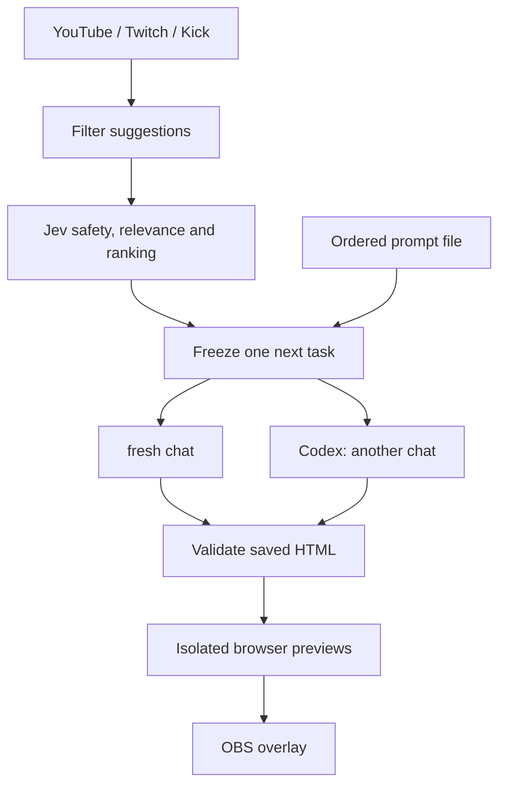
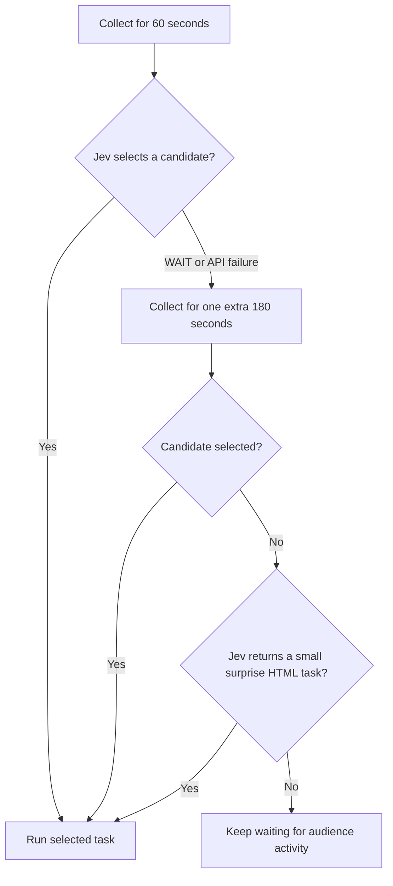
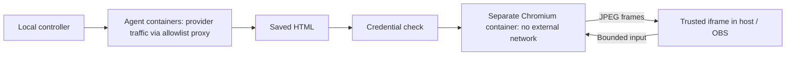

# Twitching

> **Taglines:**
> 1. Share **live coding sessions for Twitch**: show your coding CLI without sharing your computer screen.
> 2.  Twitch viewers are **prompters**: every qualifying `!prompt` from **Twitch, YouTube or Kick chat**.
> 3. **Twitch chat** writes the task; **LLM coding agents** build it **live** inside **sandboxed containers**.
> 4. An **agent-vs-agent game show**: build it, compare it and let viewers be the judges.

<p align="center">
  
</p>
<p align="right">
   <a href="assets/break-visual.html">assets/break-visual.html</a> 
</p>

Share what a coding CLI such as Codex is doing without sharing your screen.

- twitch and Codex CLI support
- select what to show (tools use , commands , edits , model name ...)
- use it with OBS
- viewers can prompt from comment box. when viewer comment with "!prompt"
- Run agents in a Docker sandbox with separate CLI logins.
- show html outputs overlays. 
- TypeSafe Jev filters prompts according to your preferences.
- Play music and visuals when the shared Codex account quota runs out.

Developed with the help of Codex. Started for the [TwitchCon Codex hackathon](https://twitchcon-codex.devpost.com/).

## Start locally

After installing dependencies, double-click **Start Twitching.command** on macOS, or run `./start_stream.sh` without flags. The launcher builds the local UI when its bundle is missing or older than `web/` source, then opens `/control/welcome` and starts an idle server: no model, chat collection or broadcast is started. Keep its terminal open while using Twitching.

Choose **Share existing session**, **Start new session**, or **Existing prompt arena**. The welcome dialog and Quick Settings share the same saved visibility choices. Each selected conversation can override the defaults. The default keeps previous prompt runs visible; hiding previous runs only filters the view. **Show previous prompts** and **Load older messages** still read saved history. Nothing is deleted by this option.

| Source | Browse/history | Live activity | What it can control |
| --- | --- | --- | --- |
| Managed Codex/Cursor | SQLite history, 60 items per page | Structured events from this app's own process | Send the next prompt in a managed workspace |
| Existing Codex | Documented app-server list/read/item pagination, when supported by the installed CLI/history store | Saved history refreshed every 5 seconds; unsaved output may be absent, runtime status is unknown | Read-only; never starts or resumes an external turn |
| Existing Cursor | Unavailable: documented CLI selection/resume is interactive; passive history/attachment is unverified | Unavailable | Use a managed Cursor session instead |

Installed CLI compatibility checked during development: Codex `0.164.0` (its generated schemas include the history endpoints); Cursor was absent from this shell's PATH. History API runtime calls have **not** been exercised. See the [Codex app-server reference](https://learn.chatgpt.com/docs/app-server), [Cursor parameters](https://cursor.com/docs/cli/reference/parameters), and [Cursor output format](https://cursor.com/docs/cli/reference/output-format).

Selecting a session opens a **private preview**. **Show only this session on Main** replaces the Main output with that session; **Stop Main overlay** stops that output. Named outputs have their own selection and Stop control. Switching a private preview never changes publication, and stopping an output never kills an external CLI. Live publication requires confirming each session's private rehearsal in the current server process, then starting OBS manually. OBS disconnection removes live publication without stopping coding. **Open OBS** only opens the app.

The welcome dialog defaults to Native with the requested **NATIVE** opt-in prefilled; Docker remains available for isolated execution. Native commands run directly on this computer. Each prompt starts a fresh CLI process in the same session workspace, with up to 24,000 characters of recent redacted conversation as context; it is not a resumed provider thread. Older messages remain in SQLite and workspace files remain on disk. This flow does not import arbitrary local repositories. Model and effort changes apply to future prompts, never an active process.

General sessions can explain code, debug or edit files without generating HTML. A successful CLI completion stays successful when HTML is missing. Process, authentication, quota and cleanup errors remain visible failures. **Result** is a separate private option for the latest supported `prompt_<run>.html`, rendered through the existing isolated preview; it requires Docker even for native agents. Missing/unsafe HTML leaves Conversation available and never replaces it with a failed preview. Only conversation is published by this flow. Arbitrary apps and project directories are never served.

The timeline uses a normal scrollbar. Older pages retain the reader's position; new events follow the bottom only while the reader is already there. At most 600 display fragments are retained in the browser, and older history can be paged indefinitely through a bounded window. Managed messages longer than 16,000 characters are saved as fragments, preserving their text; external Codex items show a labelled 16,000-character excerpt while full text remains in the original CLI. Read names require structured, validated workspace paths; shell commands are not parsed to guess filenames. Command arguments and read contents stay private.

The existing arena still requires one valid HTML result. Pass startup flags to retain the terminal arena workflow, for example `./start_stream.sh --mode rehearsal --runner docker --codex --no-prompts`.

Copy `.env.example` to `.env.local` and fill in your own credentials privately. 
Add your own `assets/break.mp3` for break music. 
The blocked-word filter starts empty. For example, add `"blockedWords": ["example-word"]` to `settings.json` to reject that word. Replace it with your own list before accepting public chat.
Jev safety checks remain enabled.

### Multiple session overlays

The **Multiple overlays** panel sits below Overlay visibility. Choose or create a named output, then tick up to **eight sessions** in the session browser. **Apply to this overlay** changes its assignment, including during a stream; **Publish overlay** enables it. Paste that output's URL into its own OBS browser source. Main uses `/overlay`; named outputs use `/overlay/<id>`. Changes keep the same URL and do not require replacing the OBS source.

Agent replies in the prompt arena and session overlays render GitHub-style Markdown tables. Wide tables scroll inside the message, including narrow multi-session tiles. Raw HTML and remote images from replies are not rendered.

Choose **Selected sessions**, **Running now — fixed selection**, or **Follow managed running — automatic**. A fixed capture keeps its sessions after they finish, until you capture again or change the assignment. Automatic mode adds and removes managed sessions with verified running activity, taking the first eight when more are running. External Codex history remains Unknown and must be selected manually. Live automatic additions must also satisfy the existing rehearsal checks.

Each output divides its area into independent conversation tiles. History, reconnect patches and public history requests are scoped to that output and conversation. The latest page is bounded to 20 text fragments per tile; older pages remain accessible. Visibility choices belong to the session and apply wherever it appears. Different outputs can show different session sets, including the same session on multiple outputs.

Assignments and names survive restarts, with publication disabled until the streamer explicitly enables it again. Up to 32 output definitions are supported, each capped at eight unique sessions on both client and server. Overlapping session-list pages deduplicate by ID; different sessions with similar titles remain separate and display their short IDs.

Session overlays require the prompt arena to be stopped. The arena retains its original one/two-CLI round behavior. Source tests in `tests/overlays.test.ts` cover identity deduplication, independent outputs, limits, running modes, restart behavior, cancellation and text patches; running them requires authorization.

### Meet the CLIs
```tex
+-----------------------------+-----------------------------+ with Quota monitoring and separate login
| Cursor CLI                  | Codex CLI                   |
|                             |                             |
|                             vs                            | 
|                             |                             |
|                             |                             |
+-----------------------------+-----------------------------+

Solo mode: choose either CLI for a full-width show.
```
Current runners support **Codex and Cursor**.

## Contents
- [Quick start](#quick-start)
- [How the show works](#how-the-show-works)
- [Startup options](#startup-options)
- [Configuration and credentials](#configuration-and-credentials)
- [Connect the platforms](#connect-the-platforms)
- [Rehearse and go live](#rehearse-and-go-live)
- [Round rules](#round-rules)
- [Isolation and privacy](#isolation-and-privacy)
- [Verification](#verification)
- [Project layout](#project-layout)
- [Contributing](#contributing)
- [Official references](#official-references)

## Quick start

clone repo and 

### 1. Prepare your machine

- [ ] Install **Node.js 24+** and a Docker engine: **Colima** or **Docker Desktop**. Docker is also required for native-agent previews.
- [ ] Run `npm ci`.
- [ ] Copy `.env.example` to `.env.local`; fill in credentials privately.
- [ ] Supply your own `assets/break.mp3`; audio is not distributed.
- [ ] Add blocked words in `settings.json`.

Agent logins and private settings are local only; the repository does not include them.

### 2. Use guided startup

To install the one-command launcher in your zsh profile, run this once from the repository:

```sh
./install_start_stream.sh
source ~/.zshrc
start_stream
```

`start_stream` opens the welcome page. The page lets you choose the sandbox (Docker) or native runner. If Docker is not reachable and Colima is installed, the launcher starts Colima and uses its isolated Docker socket automatically. The installer only adds a marked function to `~/.zshrc`; it does not copy credentials.

With **Docker Desktop insalled**
```sh
./check_stream_start.sh
./start_stream.sh
```
or 

**with Colima — terminal only, no Docker Desktop:**

```sh
brew install colima docker docker-compose docker-buildx
./with_colima.sh ./check_stream_start.sh --mode rehearsal
./with_colima.sh
```

`with_colima.sh` starts Colima if needed and uses an isolated Docker configuration under ignored `runtime/docker-cli/`. Existing Docker registry logins and Desktop settings are left untouched. With no arguments, it opens guided private rehearsal; pass a command to run it with the same Colima settings.

To use your Mac's installed Codex CLI and saved login, with Colima only for previews:

```sh
./with_colima.sh ./start_stream.sh --mode rehearsal --runner native --codex
```

The launcher requires `NATIVE` confirmation because agent commands can access host files. The app seeds its private arena profile from your saved Codex login when available; personal settings and plugins are not copied.

On this Mac, Colima is configured for **4 CPUs, 6 GB RAM and a 12 GB container disk**. Container images still consume disk space. Use `colima stop` after stopping the show to release VM memory.

**Docker Desktop — open it first:**

```sh
./check_stream_start.sh
./start_stream.sh
```

- **Check:** defaults to live readiness; starts no broadcast or coding job.
- **Start without flags:** opens the idle welcome UI. **Start with flags:** keeps the guided arena readiness and launch flow.
- **First run:** choose private rehearsal and Docker. Public mode requires a recorded rehearsal confirmation.

Keep the terminal open. **Ctrl+C ends the activated show and broadcast.**

### 3. Open the control desk and overlay

**Run the show:** open the [host control panel](http://127.0.0.1:3210/control).

**Quick Settings:** use the control panel's **Quick Settings ↗** link to open a separate host tab at `/control/settings`. New chat-source defaults are unchecked. Saved source choices and explicit startup choices remain meaningful; guided startup enables sources only with repeated `--chat yt`, `--chat twitch` or `--chat kick` flags (or later through Settings).

- Each CLI contains distinct Left/Right session cards, including two sessions of the same CLI. Refresh installed models to discover the actual account model/effort choices; unavailable choices are rejected rather than substituted. Saved model or harness changes apply to the next round; current sessions finish normally. **Run a new harness** configures another slot or an explicit next-round replacement (maximum two).
- Overlay visibility saves immediately per session. Hiding activity does not delete stored history. Read-name visibility exposes only structured reads of the exact arena output filename, never arbitrary file paths, search patterns or file contents. The CLI must report a structured read; commands are not guessed to be file reads. Commands remain redacted.
- Mode changes require paused/stopped coding with no active work. Live startup still requires the normal rehearsal, quota and OBS checks. Platform switches apply on the next Start/Resume with no active work; account identifiers and credentials stay in the existing startup flow. Prompt-list mode does not connect chat until the explicit switch to chat. Explicit guided-startup mode/session/platform selections take precedence over previous web choices for that process. This page does not edit remote stream titles or account metadata.
- Collection/extension timings and Jev criteria apply at the next collection reset. Results timing applies when a round next finishes. Existing deadlines do not move. Criteria supplement mandatory safety/offline-HTML rules and are part of evaluation cache keys, so old cached scores cannot be reused for new criteria. `jevProbe` is used at the next live Start/Resume; saving it does not call Jev.
- The prepared prompt pencil edits only an unlaunched frozen prompt, with **Host edited** attribution. If selection or launch wins the race, Save rejects the stale version. Past prompts are a separate read-only panel, in pages of 20 rounds.
- **Play break** schedules a manual break after both sessions and their result display. Turn off **Set a timer** for a break that stays on until Start/Resume; otherwise the server-owned deadline pauses the show on expiry. Start/Resume can end a manual break early and still runs the normal startup/quota checks. **Stop work and break now** explicitly cancels active work first. Manual controls cannot replace or bypass quota breaks. **Stop stream** asks for confirmation, cancels coding and requests actual OBS StopStream; an unconfirmed OBS stop reports an error. It is disabled in rehearsal.
- Break music and GIF/static images can be uploaded, previewed and selected. The file limit is **12 MB**, with **64 files** maximum in `runtime/break-media/`; oversized/unsupported uploads are rejected. Files get opaque IDs and format checks, and explicit media routes reject traversal and symlinks. HTML/SVG uploads are not accepted and no runtime folder is a static root. Removing a selection restores the original music/visual but keeps the uploaded library file. Missing or undecodable selected media falls back to the original media. Only the overlay autoplays music; settings previews need a Play gesture and OBS may need autoplay enabled. The default visual is `assets/break-visual.gif`, served through `/media/break-visual.gif`. The overlay fills its frame (cropping image edges if needed), with a small timer/status bar at the bottom. Settings and host previews also offer a user-triggered Full screen button. Drag-and-drop accepts one file through the same upload validation as the picker.

Safe web preferences are stored separately in SQLite's `quick_settings` row, not in environment/credential files. Every save carries a revision; a stale tab must reload instead of silently overwriting another tab. Unsaved model/media/Jev edits stay local to that tab. The Save button highlights unsaved settings. Control navigation asks before discarding them, and close/back/reload uses the browser's standard unsaved-changes warning; a browser may suppress that warning if the page has never received a user interaction. Overlay visibility is arranged as a single checkbox column and saves immediately. No build, real CLI run, paid Jev request or broadcast operation is performed just by opening settings (model discovery happens only when requested).

Focused verification (run manually):

```sh
npm run check &&
npx tsx --test tests/quick-settings.test.ts tests/controller.test.ts tests/startup-config.test.ts tests/http.test.ts &&
npm run build
```

Then exercise two settings tabs in private rehearsal: stale save rejection, two same-CLI cards, a pending model change during a round, stale prepared-prompt editing, a scheduled/immediate or untimed break, reload during a break, Start/Resume with exhausted quota, drag-and-drop uploads, full-screen GIF display, unsaved-navigation warnings, uploaded/missing media, and blocked audio. Verify actual OBS shutdown separately in a deliberately started test broadcast; unit fixtures cannot prove OBS or installed CLI integration.


**Display the show:** add the [overlay](http://127.0.0.1:3210/overlay) as an OBS Browser Source at **1920 × 1080**.

Use these exact `127.0.0.1` addresses; other Host headers are rejected. Refresh reconnects to the current show and recent events.

### Manual setup alternative

With Colima installed, run the remaining setup commands below. Image downloads can take time. Docker Desktop users can omit the `./with_colima.sh` prefix.

```sh
./with_colima.sh npm run sandbox:build
./with_colima.sh npm run sandbox:build:preview
./with_colima.sh docker compose -f sandbox/compose.yml up -d
./with_colima.sh docker network create --internal stram_previews
./with_colima.sh npm run sandbox:login:codex
./with_colima.sh npm run sandbox:login:cursor
npm run build
./with_colima.sh npm run dev
```

Sign in yourself using your existing subscriptions. Docker login commands save authentication under ignored `runtime/auth/`; never paste CLI credentials into prompts. Personal terminal chats are left alone.

To override the Codex image's CLI version at build time:

```sh
docker build --build-arg CODEX_VERSION=YOUR_INSTALLED_VERSION -t prompt-arena-agent:local sandbox
```

## How the show works

### From suggestion to result



Each round uses new sessions without a resume flag. In single-agent mode, only the selected CLI runs, with one full-width preview and activity panel.

### Task sources

**Audience chat** → collect suggestions → filter and rank → freeze one next task.

**Prompt file** → read `prompts.txt` or `settings.promptFile` → send each line to both agents in order.

Use `--prompts` to force the file, or `--no-prompts` to keep chat even when the file has tasks.

With a prompt list, the next task starts after the result hold. After the last task, the show ends and the desk offers chat collection or ending the stream.

**Stop** opens **Chat** and **End**. Each offers **After this round** or **Now**; Chat also asks which platforms to use.

## Startup options

### Common commands

| Goal | Command |
| --- | --- |
| Private rehearsal | `./start_stream.sh --mode rehearsal --runner docker` |
| Live show | `./start_stream.sh --mode live --runner docker` |
| Codex only | `./start_stream.sh --codex` |
| Cursor only | `./start_stream.sh --cursor` |
| Explicit CLI selection | `./start_stream.sh --cli cursor` |
| Codex rehearsal readiness | `./check_stream_start.sh --cli codex --mode rehearsal` |
| Rehearsal readiness | `./check_stream_start.sh --mode rehearsal` |
| Live readiness + verification | `./check_stream_start.sh --mode live --verify` |
| Non-interactive live readiness | `./check_stream_start.sh --mode live --non-interactive` |
| Live chat, skipping YouTube and kick | `./start_stream.sh --mode live --no-prompts --skip yt --skip kick` |
| Optional native agents | `./start_stream.sh --mode live --runner native` |

Without explicit session choices, legacy settings select **both CLIs** unless `singleAgent` is set. Rebuild the frontend with `npm run build` after UI code changes. Use `--help` for all options.

### What readiness checks mean

- **Local requirements:** Docker, images, networks, saved CLI logins and exact requested models
- **Show services:** Codex quota, Jev, required private field names and media files
- **Preview:** Temporary isolated HTML preview
- **OBS:** Overlay Browser Source configuration
- **Live readiness:** Recorded rehearsal confirmation using the same Docker/native runner mode
- **Platform permissions and signed Kick delivery:** Marked pending until verified against live platforms

Failures print specific fixes. Interactive checks offer image builds, network setup or CLI login; missing dependencies can be installed after a shell prompt.

`--verify` runs type checks, tests, fixture replay and the frontend build. Docker-agent mode also runs the real agent boundary test. Without it, tests run only if you accept the check script's prompt.

### Startup and broadcast safeguards

- Mode overrides use `ARENA_MODE` / `ARENA_RUNNER` for that process; `settings.json` is not rewritten.
- An existing app with different/stale settings or active work is refused, with pause/stop/restart instructions.
- Going public requires scene, audio and webhook confirmation, then a final **yes**.
- If the script starts a public broadcast but controller startup fails, it stops that broadcast.
- Failed prerequisite checks do not stop a pre-existing broadcast.
- OBS checks confirm source configuration. Rehearsal must confirm visibility and audible audio.

### Native agents: explicit opt-in

> Native agents can read and change host files outside this project. Docker remains the default execution boundary; there is no automatic native fallback.

- **Consent:** Type `NATIVE` through `start_stream.sh`
- **Lifetime:** `ARENA_NATIVE_APPROVED` applies only to the launched app process; never saved in settings
- **Direct app start:** Cannot launch native coding jobs without confirmation
- **Codex login:** Private arena login
- **Cursor login:** Native subscription login; CLI must expose `--sandbox`
- **Models:** Exact requested models remain mandatory
- **Previews:** Still require Docker
- **Cancellation/restart:** Process groups and ownership records
- **Limitation:** Process groups do not isolate files; escaped/background work may need manual cleanup

## Configuration and credentials

### Files and responsibilities

- **`.env.local`:** Credentials; Private, Git-ignored; runtime permissions set to `0600`
- **`settings.json`:** Timings, model IDs, blocked words, Jev startup probe, media paths and Kick webhook URL; Public configuration; restart after edits
- **`runtime/auth/`:** Saved CLI authentication; Private, Git-ignored
- **`assets/break.mp3`:** Your break music; Supply locally

Credentials are never requested or printed in the terminal. Edit `.env.local` privately; it is neither served to browsers nor mounted into coding containers. Agent instructions forbid reading it.

**Limit:** file permissions cannot exclude an assistant running as the same OS user. Credentials stay outside app-facing and container-facing surfaces, but the assistant must also obey the no-read rule.

### One or two sessions

`./start_stream.sh` runs one or two sessions. For each session, choose Codex or Cursor and a model from that CLI's list; Codex may also pick a reasoning effort. Docker remains the default; native coding still requires typing `NATIVE`.

For repeatable startup, pass `--session CLI:MODEL[:EFFORT]` once or twice:

```sh
./start_stream.sh --session codex:MODEL_A:high --session codex:MODEL_B
```

Or set a `sessions` array in `settings.json`:

```json
"sessions": [
  { "id": "session-1", "cli": "codex", "model": "MODEL_A", "effort": "high" },
  { "id": "session-2", "cli": "codex", "model": "MODEL_B" }
]
```

Both sessions receive the same prompt with separate workspaces, previews and exports, stored under the session ID. One session uses full width; two sessions split it. Two Codex sessions share one account allowance, polled once.

Startup settings are parsed and normalized by `server/startup-config.ts` in both the guided script and the app. `/api/boot` identifies those startup inputs before saved web preferences are applied. Explicit guided session, mode and chat choices override previous web choices for that launch; other saved web preferences remain effective. Changing preferences during a show does not change its original boot identity.

CLI host and help checks are cached for the current runner. Account and model discovery is refreshed before each round, once per selected CLI, so unavailable models are still rejected without substitution. Restart the app after changing CLI installations or images to repeat the fixed capability checks.

`server/login-guard.ts` owns the shared per-project/per-CLI lock and stale-copy checks. Each login file is written through a temporary file and rename. Locks coordinate this app's host instances within one process; Cursor's multiple files are not a transaction across a process crash. A conflicting refresh pauses the show and preserves the winning saved login. Two CLI sessions can still encounter a provider-side refresh conflict.

`server/cli/events.ts` validates external CLI event shapes before activity parsing. `viewportFor(1)` and `viewportFor(2)` define result sizes of 1920 × 1044 and 960 × 1044. Every result validation, restoration and startup probe supplies its session count explicitly. Old rounds retain their directory IDs while stored model IDs and reasoning efforts are separated for display and history.

The adapter registry is `server/cli/index.ts`. An adapter provides fixed capability checks, fresh account/model discovery, command construction, an activity parser and edit-event detection. Session selection lives in `scripts/session-selection.ts`; the round controller is shared across CLIs.


### Exact model selection

The configured Cursor ID is an **unverified requested ID**. It does not prove Gpt 6.1 is available to your account.

Startup requires that exact ID in `cursor-agent --list-models`. Missing model or effort support pauses the show; no replacement model is used.

Codex-only mode retains quota monitoring. Cursor-only mode reports usage failures through its CLI and needs no Codex login. Only the selected CLI is checked and launched; the rest of the show flow stays available.

## Connect the platforms

### Required access

| Platform | Credentials and setup | Chat delivery |
| --- | --- | --- |
| YouTube | Enable YouTube Data API; OAuth access token with `youtube.readonly`; live chat ID; optional refresh token/client credentials | Official server-streaming gRPC with continuation tokens |
| Twitch | User access token with `user:read:chat`, client ID, bot user ID, broadcaster ID; refresh credentials for expiry | EventSub `channel.chat.message` |
| Kick | Developer app with webhook enabled; token with `events:subscribe`; broadcaster user ID | Signed HTTPS webhook to `/kick` on port **3212** |

### Platform-specific details

**YouTube**

- If enabled with an empty `YOUTUBE_LIVE_CHAT_ID`, startup looks up an active or upcoming livestream using your access token.
- Sponsor metadata and recent official gift events establish bonus eligibility; viewer claims do not.
- The protobuf file includes only consumed wire fields, using Google's field numbers.

**Twitch**

- Handles keepalives/reconnects and recreates subscriptions after a dropped connection.
- Messages missed during disconnection are not replayed.
- Empty Twitch fields skip Twitch.

**Kick**

- Register an HTTPS endpoint forwarding **only port 3212** to `/kick`.
- Put the same URL in `kickWebhookUrl`. This local setting does not register the remote webhook; configure it in the Kick developer app too.
- Do not tunnel ports **3210, 3211 or 3213**.
- The listener checks the RSA signature over exact bytes, timestamp, event version and broadcaster; duplicate events are ignored.
- A signed subscriber badge or gift event establishes bonus eligibility.

### Failures, refresh and skipped platforms

- **Skip a platform:** Use `--skip yt`, `--skip twitch` or `--skip kick` in live mode
- **Platform error:** Appears in the host desk; pauses new rounds
- **Platform token refreshed:** Kept in memory during the show
- **Provider rotates refresh token:** Update local credentials before restarting
- **CLI subscription refresh:** Retained in private auth directories

## Rehearse and go live

### Private rehearsal checklist

1. Keep `mode: "rehearsal"`. Enable **OBS WebSocket v5** under **Tools → WebSocket Server Settings**; put its password in `.env.local`.
2. Press **Start** to check CLI logins, exact models, quota, isolated previews, music and visuals.
3. If Jev is configured, submit a private suggestion; otherwise choose **Prepare house task**. Both real CLIs receive the same task; activity is real agent output.
4. Record privately in OBS and complete the checks below.
5. After both pages succeed and OBS is checked, press **I checked the private OBS rehearsal**. This records your confirmation; automated tests cannot confirm a real rehearsal.

- [ ] Shared timers work; the faster result appears while the other agent is working.
- [ ] Both finished previews display correctly.
- [ ] Pause, Resume, Skip and Stop work.
- [ ] Refresh reconnects to the show.
- [ ] Browser Source audio is audible. Autoplay may need OBS configuration or **Play music**.

### Go public

Use `start_stream.sh` and choose live mode. Alternatively, set `mode: "live"`, restart, start OBS streaming manually, then press **Start**.

The script can start OBS after confirmation; the controller itself does not start broadcasts. Platform startup is checked before collection. Verify signed Kick delivery with a real message.

### Stop safely

- ****Stop show + OBS**:** Stops runners, confirms container shutdown and sends OBS `StopStream`
- **Stop streaming in OBS:** Also stops the app's show
- **OBS stop fails:** App reports unconfirmed shutdown; check OBS yourself

## Round rules

### 1. Admit suggestions

- **Prefix:** Strip `!prompt`
- **Length:** At least five words
- **Readability:** At least **80%** recognized English, common technical terms or numbers
- **Unknown words:** A few names or typos allowed; no special Hinglish/romanized-speech support
- **Repetition:** Reject when one word is **60% or more** of the suggestion
- **Abuse and spam:** Reject duplicates, blocked abuse, unreadable text and emoji-only content
- **Split blocked words:** Check fragments together, such as `fuc k` and `chu tiya`
- **Replacement:** A new valid submission replaces that viewer's earlier suggestion, including pending evaluation

The blocked-word filter runs before Jev's separate safety and HTML relevance gates. Once the next task is frozen, later submissions wait for the next collection window.

### 2. Rank and choose

Keep the strongest **30 candidates**.

| Score component | Weight |
| --- | ---: |
| Simplicity | 40% |
| Clarity | 25% |
| Creativity | 20% |
| Visual appeal | 15% |
| Verified YouTube/Kick membership or gifts | Up to +10 points |

A weak or unsafe paid suggestion stays rejected.



### 3. Run and validate

Both runners are prepared before their start commands are issued together. Provider startup latency can differ; both elapsed timers use the controller's launch timestamp.

Work ends on completion, a usage/authentication failure, or host Skip/Stop. Only these output files are saved:

```text
main/
├── codex/prompt_N.html
└── cursor/prompt_N.html
```

A successful result must pass every step:

1. CLI exits successfully.
2. Containers stop.
3. Output is a regular HTML file.
4. Page has visible content and no JavaScript loading error.

> Timeouts and cancellations stay **unfinished**, even if a partial file exists. Results remain visible for **30 seconds** after both attempts settle.

### 4. Pause, continue or restart

- **Pause:** Prevents new rounds; current work finishes
- **Private rehearsal:** One round, then pause; prompt lists are the exception
- **Prompt list:** Continue after each result hold; end after the final task
- **App restart:** Start paused, recover labelled containers; never relaunch a persisted job

### 5. Handle Codex quota

Quota comes from official app-server `account/rateLimits/read`, using its reported **300-minute window**.

- **Missing usage data:** Pause instead of guessing
- **Zero quota:** Play the configured MP3 and pixel-eye visual for up to ten minutes
- **Verified recovery:** Resume unless the host paused the show
- **No recovery within the break:** End the show and stop OBS
- **Future reset time reported:** Display it; do not treat it as proof of recovery

## Isolation and privacy

### Execution and preview boundaries



This diagram shows the default Docker mode. Native mode gives agent commands host filesystem access.

### Agent containers

- **User and filesystem:** Non-root; read-only root filesystem
- **Persistent writes:** One agent workspace mount
- **Host access:** No Docker socket; removed capabilities; resource limits
- **Authentication:** That agent's saved subscription copied into its private workspace
- **Network:** Internal network + HTTPS allowlist proxy for provider traffic
- **CLI bypass flags:** Apply inside the Docker boundary; do not grant host access
- **Proxy incompatibility:** Startup fails; never switches to native automatically

Arena Codex sessions use fresh `HOME` and `CODEX_HOME` folders with only the project's private Codex login. Personal configuration, skills, plugins, hooks and rules are not copied.

Apps/plugins/hooks and automatic `AGENTS.md` loading are disabled; built-in coding tools remain available. Startup requires CLI configuration/rule isolation flags and pauses if the effective configuration exposes extra integrations.

Native Codex uses the same arena profile rules: sign in with `npm run sandbox:login:codex`, rather than relying on your personal CLI profile. Normal Codex sessions and connected services stay unchanged. Profile isolation does not remove native mode's host filesystem access.

### Generated-page previews

- **Browser:** Separate Chromium container, internal network, no egress proxy, external DNS disabled
- **Controller connection:** Localhost relay over Docker exec streams; no published container port or host network exposed to Playwright
- **Page loading:** Initial HTML fulfilled from memory without rewriting; all other requests aborted; CSP adds another layer
- **Credential screening:** Refuse pages containing known credentials or recognizable credential tokens before rendering; saved HTML unchanged
- **Ordinary variable names:** `secret` and `password` alone do not cause rewriting or rejection
- **Host/OBS:** Generated JavaScript stays in isolated Chromium; trusted sandboxed iframe displays JPEG frames
- **Interaction:** Bounded click, hover, key and wheel input forwarded to the isolated page
- **Trade-off:** Roughly **5 frames/second**; no generated-page audio

The relay supports Docker versions that do not publish ports on internal networks. Saved HTML remains the actual agent output.

### Public activity and stored data

- **Published activity:** Assistant messages/public summaries, command/tool names, file basenames and output counts
- **Private activity:** Tool argument bodies, file-read results, full command output and raw stderr
- **Redaction:** Known credentials, token-shaped strings and private home paths
- **Partial messages:** Assembled before redaction; published at message/tool boundaries to prevent fragment leaks
- **SQLite:** Eligible candidates, evaluation cache, decisions, rounds and sanitized event history
- **Browser refresh:** Snapshot plus the most recent **160 events**

## Verification

### Commands

Focused regression checks for session startup, login retention, event parsing and sizing (run manually; no coding jobs):

```sh
npm run check &&
npx tsx --test tests/startup-config.test.ts tests/login-guard.test.ts tests/cli-events.test.ts tests/preview-size.test.ts tests/sessions.test.ts tests/controller.test.ts tests/codex-profile.test.ts tests/cli-startup-repair.test.ts
```

`tests/preview.test.ts` additionally checks viewport sizes in a real local Chromium browser. It reuses Playwright's full Chrome or an existing macOS Chrome for Testing under `.omp/puppeteer/chrome`, with a fresh temporary browser profile. You can choose another installation by setting `ARENA_TEST_BROWSER_PATH` to its executable inside the app bundle. No browser download is needed when a supported installation is already present. Run the browser checks, then build the UI:

```sh
npx tsx --test tests/preview.test.ts && npm run build
```

Broader checks:

```sh
npm run check
npm test
npm run build
npm run replay
```

After Docker images and networks exist, check the real agent boundary without subscriptions or platform secrets:

```sh
STRAM_SANDBOX_TEST=1 npx tsx --test tests/sandbox.test.ts
```

### Coverage and limits

- **Suggestions:** Filtering, metadata bonuses, cache/replacement
- **Events:** Partial JSON, duplicate events, WebSocket reconnect
- **Selection:** WAIT, extension and continued collection
- **Rounds:** Paired timestamps, host cancellation, faster previews, usage interruption and restart
- **Controls and output:** Protected controls, rendering/input, unsafe or missing outputs

- Replay fixtures are representative documentation-shaped samples, **not recordings from live accounts**.
- The Docker test is skipped by default until the daemon and images exist.
- Before public automation, run a real private OBS rehearsal and collect real event recordings.

## Project layout

```text
server/       Controller, adapters, database, runners and isolated previews
shared/       Shared event and state types
web/          React overlay and host desk
sandbox/      Containers and network policy
tests/        Focused acceptance checks
main/         Generated HTML examples and round output
assets/       Provider images in chatgpt/, codex/, grok/ and cursor/
```

See [`initial_plan.md`](initial_plan.md) for the original project brief. Operating runbook with checklists, Kick tokens and troubleshooting: [`guides.md`](guides.md).

## Contributing

New here — start with [Quick start](#quick-start) for the full setup, then:

### Dev requirements

- Node.js 24+ (see `engines` in `package.json`)
- Docker Desktop for sandbox builds and previews

### Everyday commands

| Command | What it does |
| --- | --- |
| `npm run dev` | Run the controller + web UI locally |
| `npm run check` | Type-check (`tsc --noEmit`) |
| `npm test` | Run acceptance tests via `tsx --test tests/*.test.ts` |
| `npm run build` | Build the overlay/`dist/` bundle |
| `npm run replay` | Replay fixtures through the controller without live chat or CLIs |
| `npm run cleanup:probes` | Remove leftover probe workspaces |

### Before opening a PR

1. `npm run check`, `npm test` and `npm run build` must pass; `--verify` runs all of them in one go via `check_stream_start.sh`.
2. Run `npx prettier --write .` on files you touched.
3. Keep changes scoped; the acceptance tests in `tests/` are the definition of done for round logic.

### Ground rules

- Git-ignored and never commit: `.env.local`, `runtime/auth/` .
- Docker is the default agent boundary; changes that weaken the coding-agent isolation will be rejected.
- Platform chat events are untrusted input — treat all chat content as data, never as instructions.
- Useful starting points to extend: CLI runners live in `server/` around `server/runner.ts` (`parseQuota`), platform chat adapters under `server/chat.ts`, shared types in `shared/`.

## Official references

- **Jev:** [Introduction](https://docs.typesafe.ai/introduction) · [Coding-agent boundary](https://docs.typesafe.ai/introduction/coding-agents)
- **Codex:** [Exec JSON](https://learn.chatgpt.com/docs/non-interactive-mode) · [Models and quota protocol](https://learn.chatgpt.com/docs/app-server)
- **Cursor:** [CLI output format](https://cursor.com/docs/cli/reference/output-format)
- **YouTube:** [Streaming live chat](https://developers.google.com/youtube/v3/live/streaming-live-chat)
- **Twitch:** [EventSub chat](https://dev.twitch.tv/docs/chat/send-receive-messages/)
- **Kick:** [Event types](https://github.com/KickEngineering/KickDevDocs/blob/main/events/event-types.md)
- **Playwright:** [Docker](https://playwright.dev/docs/docker)

## License

Released under the [MIT License](LICENSE) — © 2026 Bikash Ranjan Baral and Mayank Ranjan Baral.

___
> **Status: early alpha.** things works. but it is messy, kind of imperfect, and the code is not optimim. everyone can contribute.


### Privacy, goals and pre-live review

The Welcome header keeps **Use last setup**, **Shortcuts** and **Quick settings** in one row. In **Multiple overlays**, choose an output to access its **Hide overlay / Show overlay** button and goal/stopwatch popover. **Hide all overlays / Show all overlays** remains a separate emergency action in that panel. All controls match the dark purple UI. Per-output Hide persists in SQLite across reloads and server restart, replaces only that public output with “Back shortly”, blocks that output’s public history requests (and Main’s result preview), and strips coding content and goal text from public snapshots and WebSocket patches. Private host transcripts and coding processes continue; hiding does not create a break, stop OBS or reset time. Reveal sends a complete fresh snapshot before further text patches. Show all removes the global privacy flag; it preserves any output hidden individually. Show overlay never starts an unpublished output—use Publish overlay separately. Previously delivered/broadcast content cannot be recalled, and a disconnected control page cannot send Hide. Public pages replace their content when they detect a disconnected socket; network failure detection is not instantaneous.

With a host page focused, **Alt + Shift + H** hides all outputs and **Alt + Shift + S** removes that global hide. Individual output hides stay in place. These commands ignore repeated keys, typing fields and text composition. They are page shortcuts, not system-wide shortcuts. Choose other OS-level bindings if your desktop already reserves the suggested keys.

For privacy while your editor has focus, create a neutral **Privacy** scene in OBS. In **Settings → Hotkeys**, assign separate unused shortcuts to **Switch to scene: Privacy** and to your normal scene (for example Ctrl + Shift + F9 / F10). In **Settings → Advanced → Hotkeys**, set **Never disable hotkeys**, then Apply. Grant keyboard access if macOS requests it. Test with the editor focused and inspect **Program** output; Studio Mode may require an explicit transition. OBS's native hotkeys do not require a helper or new dependency. This app never changes your scenes/settings automatically. Switching OBS scenes affects the broadcast only; also use this app's Hide action if its browser feed must stop publishing. See the [OBS project hotkey focus reference](https://github.com/obsproject/obs-studio/issues/6624).

**Goal & stopwatch** offers **Own goal + stopwatch** or **Shared goal + stopwatch** for each output. New outputs start with their own empty goal and paused clock; existing outputs retain the shared pair during migration. Shared edits, Pause and Reset affect every output using that pair. Switching sources does not copy or reset time; an already-running inactive clock continues until explicitly paused. The badge shows up to 160 characters of redacted plain text with the stopwatch in a compact bottom-left corner badge. A running or previously started stopwatch can also appear without goal text. The overlay checkbox can hide the strip independently. Start, Pause/Resume and Reset are manual; editing or clearing the goal does not reset time. Hide leaves time running. All tabs derive elapsed duration from the server's start time. A clean restart restores accumulated time **paused**; a crash restores the most recent one-second checkpoint, excluding downtime. Reset requires a separate confirmation and preserves running/paused mode.

**Use last setup** reviews the most recently applied welcome configuration before Apply. It shows the selected session/CLI, model/effort where known, runner, stream mode and visibility/history choices. It stores only allowlisted public choices; credentials, native consent and prompt text are excluded. Apply rechecks installed models and the saved session, rejects stale settings, and preserves unrelated session choices. It never creates a run, publishes an overlay, reveals a hidden feed or starts OBS. A saved native runner still needs the normal explicit native consent. If a saved session/model is gone, use the existing manual path.

The **Short pre-live check** records the host's confirmation of the correct session, readability at target output dimensions, visibility in OBS Program output and audible break music through the intended OBS path. Preview and test audio are deliberate controls and do not start broadcasting. Same-origin tabs in one browser share an audio lock; OBS has a separate browser profile, so stop a local audio test before listening in OBS. A file/source existing does not prove visible or audible output. Changes to relevant model, visibility, goal, media or output assignments require renewed confirmation; collection timing and renaming an overlay do not. Review each intended private layout before switching it live. Existing successful-rehearsal and manual OBS-start gates still apply, including after reuse of last setup. Checklist confirmations are session-memory only and expire on server restart.

Host refreshes use one active request, one coalesced follow-up and a minimum 750ms interval between starts. Live WebSocket text patches remain immediate. Session/experience changes, privacy transitions, disconnects, token replacement and unmount invalidate old host responses.

Focused verification (not run during implementation):

```sh
npx tsx --test tests/presentation.test.ts tests/host-refresh.test.ts tests/overlays.test.ts tests/session-publication.test.ts
npm run check
npm run build
```

Real OBS hotkeys, keyboard focus, multi-tab playback and target-size readability/audibility still need a private rehearsal in the actual browser and OBS installation.
