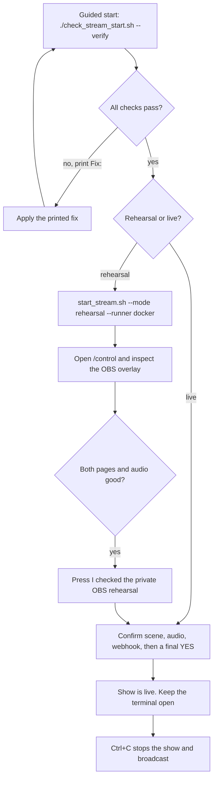

# Prompt Arena practical guide

This file is the runbook for rehearsing, testing and going live: the quick path with checklists and a flow diagram, plus platform/token setup, native-agent commands, slow-network workarounds and troubleshooting. Setup steps, startup options, isolation details and verification commands live in [README.md](README.md) and are not repeated here.

## Start streaming or rehearsal — quick path



### Rehearsal / test checklist

- [ ] Docker Desktop engine is running
- [ ] One-time setup done: `npm ci`, images built, provider proxy up, `stram_previews` network — see [README Quick start](README.md#quick-start)
- [ ] Agent logins saved (`npm run sandbox:login:codex` / `npm run sandbox:login:cursor` for Docker agents)
- [ ] `.env.local` filled privately; own `assets/break.mp3` supplied; blocked words configured in `settings.json`
- [ ] OBS: WebSocket v5 enabled with its password in `.env.local`; overlay Browser Source `http://127.0.0.1:3210/overlay` at 1920 × 1080; **Start Streaming not pressed**
- [ ] `./check_stream_start.sh --mode rehearsal --runner docker --verify` ends with `READY: rehearsal prerequisites passed`
- [ ] One private round: both agents start together, real activity, two separate HTML results, faster result stays visible
- [ ] Controls checked in separate rounds: Pause, Resume, Skip, Stop; `/overlay` refresh keeps the round; interaction reaches the finished result
- [ ] Press **I checked the private OBS rehearsal** in `/control`

To exercise chat handling without OBS or platforms, `npm run replay` simulates recorded chat and CLI events; the full automated suite is documented in [README Verification](README.md#verification).

### Go-live checklist

- [ ] Rehearsal confirmed for the **same runner mode** you will use live
- [ ] Platform credentials ready: YouTube OAuth/livestream, Twitch tokens + EventSub, Kick app token and webhook (see the Kick section below)
- [ ] `./check_stream_start.sh --mode live --runner docker --verify` passes
- [ ] Public confirmation answered: scene, audio, webhook checks, then a final **yes**
- [ ] Verify signed Kick delivery with a real message
- [ ] `Ctrl+C` stops the show and series of rounds; the controller stops any broadcast it started

## Native agents

Native mode runs Codex and Cursor directly on your Mac; preview pages stay in the isolated Docker browser. Risk and consent rules are documented in [README](README.md#native-agents-explicit-opt-in). Prepare only the preview side:

```sh
npm run sandbox:build:preview
docker network inspect stram_previews >/dev/null 2>&1 || docker network create --internal stram_previews
codex login
cursor-agent login
```

Check native mode without starting agents:

```sh
./check_stream_start.sh --mode rehearsal --runner native --verify
```

Run a private native round:

```sh
./start_stream.sh --mode rehearsal --runner native
```

The script asks you to type exactly: `NATIVE`. This confirmation is required for each launched app process and is not stored in `settings.json`. The safest native host is a separate macOS user account without personal files, cloud drives or private accounts.

## What protection does Docker-agent mode provide?

Each agent receives a separate temporary workspace. The container has a read-only base filesystem, no Docker socket, removed Linux capabilities and an internal allowlist proxy network. Full boundary details: [README Isolation and privacy](README.md#isolation-and-privacy). Generated HTML is rendered as-is; the README explains credential screening and input forwarding. Remaining risks:

- The container receives a copy of its CLI subscription authentication.
- A bad prompt can waste Codex/Cursor usage allowance.
- Temporary files can consume host disk space; there is no strict workspace disk quota.
- Generated content may be offensive, disturbing or flashing if moderation misses it.
- A page may freeze its preview, which should become a failure card.
- Docker or browser security vulnerabilities are rare but not impossible.

Keep Docker Desktop and both CLIs updated.

## Get the Kick access token and broadcaster ID

Prompt Arena can use a Kick **App Access Token**. This is the simpler server-to-server token; Kick allows it for channel lookup and event subscriptions. With an app token, `KICK_BROADCASTER_ID` is required.

### 1. Create a Kick developer app

1. Enable 2FA in your Kick account settings.
2. Open <https://kick.com/settings/developer>.
3. Select **Create App**.
4. For **Redirect URL**, enter:

   ```text
   http://localhost:3212/oauth/callback
   ```

   Prompt Arena currently uses an App Access Token, so this callback is not used during normal startup. It satisfies the app's redirect setting and gives you a local address if a user OAuth flow is added later. Redirect URL and webhook URL are different fields.

5. Under **Scopes Requested**, select:

   ```text
   channel:read
   events:subscribe
   ```

6. If you do not yet have a public HTTPS tunnel, leave **Enable webhooks** off while creating the app. You can still generate the App Access Token and find the broadcaster ID.
7. Before using Kick chat in a real show, create a public HTTPS URL that forwards only to local port `3212`. Turn **Enable webhooks** on and enter the public URL ending in `/kick`, for example:

   ```text
   https://your-public-tunnel-host.example/kick
   ```

   Put that exact URL in `settings.json` as `kickWebhookUrl`. Do not enter `localhost` in the webhook field because Kick's servers cannot reach your Mac through localhost. Do not expose ports `3210`, `3211`, or `3213`.
8. Save the app, then copy the **Client ID** and **Client Secret**. The Client Secret is private; never paste it into chat or commit it to Git.

### 2. Generate an App Access Token

Run these commands in Mac Terminal. Pasted values are kept in temporary shell variables; the Client Secret is hidden while typing:

```sh
read -r 'kick_client_id?Paste Kick Client ID: '
read -rs 'kick_client_secret?Paste Kick Client Secret (hidden): '; echo

kick_token_response=$(curl -fsS -X POST 'https://id.kick.com/oauth/token' \
  -H 'Content-Type: application/x-www-form-urlencoded' \
  --data-urlencode 'grant_type=client_credentials' \
  --data-urlencode "client_id=$kick_client_id" \
  --data-urlencode "client_secret=$kick_client_secret")

kick_access_token=$(printf '%s' "$kick_token_response" | \
  node -e 'let s="";process.stdin.on("data",c=>s+=c);process.stdin.on("end",()=>{const j=JSON.parse(s);if(!j.access_token)process.exit(1);process.stdout.write(j.access_token)})')

printf '%s' "$kick_access_token" | pbcopy
echo 'Kick access token copied to clipboard.'
unset kick_client_secret kick_token_response
```

Open `.env.local` in your editor and paste the copied token:

```text
KICK_ACCESS_TOKEN=paste_the_token_here
```

Do not run `echo $kick_access_token`, because that prints the secret to the terminal. Clear the clipboard after saving the token:

```sh
printf '' | pbcopy
```

### 3. Get the broadcaster ID for `kick.com/lofies`

With `kick_access_token` still available in the same terminal, run:

```sh
kick_channel_response=$(curl -fsS \
  -H "Authorization: Bearer $kick_access_token" \
  'https://api.kick.com/public/v1/channels?slug=lofies')

printf '%s' "$kick_channel_response" | \
  node -e 'let s="";process.stdin.on("data",c=>s+=c);process.stdin.on("end",()=>{const j=JSON.parse(s);const id=j.data?.[0]?.broadcaster_user_id;if(!id){console.error("Broadcaster ID not found");process.exit(1)}console.log(id)})'
```

Copy the printed number into `.env.local`:

```text
KICK_BROADCASTER_ID=the_number_printed_above
```

Clean the remaining temporary values:

```sh
unset kick_client_id kick_access_token kick_channel_response
```

App access tokens expire. If Kick later returns `401 Unauthorized`, repeat the token-generation step and replace `KICK_ACCESS_TOKEN` in `.env.local`.

Kick references: [App setup](https://github.com/KickEngineering/KickDevDocs/blob/main/getting-started/kick-apps-setup.md), [OAuth token flow](https://github.com/KickEngineering/KickDevDocs/blob/main/getting-started/generating-tokens-oauth2-flow.md), and [Channels API](https://api.kick.com/swagger/doc.yaml).

## Slow Internet while building the preview image

The Playwright preview image is large. Its first download can take a long time. This is a one-time cost; Docker reuses downloaded layers later.

Docker normally downloads three image layers together. On a slow or unstable connection, you can make Docker pull one layer at a time.

### Download one layer at a time

If the current download is still moving, letting it finish is usually fastest. If it keeps timing out, press `Ctrl+C` and do this:

1. Open **Docker Desktop → Settings → Docker Engine**.
2. Add `"max-concurrent-downloads": 1` to the existing JSON. Do not remove its other settings.

If the editor is currently empty except for `{}`, it should look like:

```json
{
  "max-concurrent-downloads": 1
}
```

If it already contains settings, add the new entry with the required comma. Invalid JSON can prevent Docker from restarting.

3. Press **Apply & Restart**.
4. Pull the large base image separately:

```sh
docker pull mcr.microsoft.com/playwright:v1.63.0-noble
```

5. After the pull finishes, build the small project-specific layer:

```sh
npm run sandbox:build:preview
```

The separate pull is useful because completed image layers are stored in Docker's local cache. If the connection fails, rerun the same `docker pull` command; Docker can reuse layers that finished successfully. The later build should reuse the downloaded base image.

Docker's official documentation says pulls use three concurrent layer downloads by default and recommends lowering `max-concurrent-downloads` on low-bandwidth connections: <https://docs.docker.com/reference/cli/docker/image/pull/>. Docker Desktop exposes daemon JSON under **Settings → Docker Engine**: <https://docs.docker.com/desktop/settings-and-maintenance/settings/#docker-engine>.

After the download is complete, you can remove `max-concurrent-downloads` or change it back to `3` for normal Docker use.

Best options:

1. Let the download finish.
2. Switch to a faster Wi-Fi connection or mobile hotspot.
3. Press `Ctrl+C` and rerun the pull/build later. Docker keeps completed layers, although an incomplete layer may download again.
4. Pull/build on another machine with the same CPU architecture, transfer it using `docker save`, then load it using `docker load`.

You cannot run the complete visual rehearsal without the preview image. You can skip it only for non-visual checks:

```sh
npm run check
npm test
npm run replay
npm run build
```

There is currently no native-preview option because generated pages would then execute on the Mac with weaker protection.

## Common errors and fixes

### Docker Desktop is not ready

Open Docker Desktop and wait until it reports that the engine is running. Rerun the check file.

### Preview image is missing

```sh
npm run sandbox:build:preview
```

### Agent image is missing

Required only for Docker agents:

```sh
npm run sandbox:build
```

### Provider proxy is not running

```sh
docker compose -f sandbox/compose.yml up -d
```

### Preview network is missing

```sh
docker network create --internal stram_previews
```

If the network already exists but is not internal, stop containers using it and fix it manually. The scripts will not delete an existing network automatically.

### Codex or Cursor login failed

Docker agents:

```sh
npm run sandbox:login:codex
npm run sandbox:login:cursor
```

Native agents:

```sh
codex login
cursor-agent login
```

### Requested model is unavailable

Check the model list provided by that CLI/account. The app will not silently select a different model. Update `settings.json` only after choosing an available model intentionally.

### OBS overlay source is missing

Add `http://127.0.0.1:3210/overlay` as a 1920 × 1080 OBS Browser Source and enable OBS WebSocket.

### A different or old app is already running

Use its `/control` page to Stop it, close the terminal that launched it, then rerun `start_stream.sh`. The script does not kill an unknown app.

### Live readiness says rehearsal is missing

Run a rehearsal using the same runner mode you plan to use live:

```sh
./start_stream.sh --mode rehearsal --runner docker
```

or:

```sh
./start_stream.sh --mode rehearsal --runner native
```

Finish the round, inspect OBS and confirm the rehearsal in `/control`.

## What cannot be fully simulated without streaming?

Offline/rehearsal tests cannot prove:

- Real YouTube and Twitch token permissions and live chat delivery.
- Kick's public HTTPS webhook and signed delivery from Kick.
- Actual platform reconnect behaviour during a broadcast.
- What viewers receive from the final streaming platform.
- Real audio balance after platform encoding.

Testing those items requires a private/unlisted test broadcast. The app does not claim they passed during offline simulation.

## Stop and clean up

Stopping safely is documented in [README](README.md#stop-safely). To stop the provider proxy after testing:

```sh
docker compose -f sandbox/compose.yml down
```

Generated results are saved under `main/codex/` and `main/cursor/`. Runtime state and temporary native workspaces are under `runtime/`; both locations are ignored by Git.
