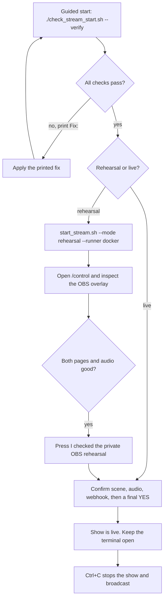

# Prompt Arena practical guide

This file is the runbook for rehearsing, testing and going live: the quick path with checklists and a flow diagram, plus platform/token setup, native-agent commands, slow-network workarounds and troubleshooting. Setup steps, startup options, isolation details and verification commands live in [README.md](README.md) and are not repeated here.

## Start streaming or rehearsal — quick path



### Rehearsal / test checklist

- [ ] Docker Desktop engine is running
- [ ] One-time setup done: `npm ci`, images built, provider proxy up, `stram_previews` network — see [README Quick start](README.md#quick-start)
- [ ] Agent logins saved (`npm run sandbox:login:codex` / `npm run sandbox:login:cursor` for Docker agents)
- [ ] `.env.local` filled privately; own `assets/break.mp3` supplied; blocked words configured in `settings.json`
- [ ] OBS: WebSocket v5 enabled with its password in `.env.local`; overlay Browser Source `http://127.0.0.1:3210/overlay` at 1920 × 1080; **Start Streaming not pressed**
- [ ] `./check_stream_start.sh --mode rehearsal --runner docker --verify` ends with `READY: rehearsal prerequisites passed`
- [ ] One private round: both agents start together, real activity, two separate HTML results, faster result stays visible
- [ ] Controls checked in separate rounds: Pause, Resume, Skip, Stop; `/overlay` refresh keeps the round; interaction reaches the finished result
- [ ] Press **I checked the private OBS rehearsal** in `/control`

To exercise chat handling without OBS or platforms, `npm run replay` simulates recorded chat and CLI events; the full automated suite is documented in [README Verification](README.md#verification).

### Go-live checklist

- [ ] Rehearsal confirmed for the **same runner mode** you will use live
- [ ] Platform credentials ready: YouTube OAuth/livestream, Twitch tokens + EventSub, Kick app token and webhook (see the Kick section below)
- [ ] `./check_stream_start.sh --mode live --runner docker --verify` passes
- [ ] Public confirmation answered: scene, audio, webhook checks, then a final **yes**
- [ ] Verify signed Kick delivery with a real message
- [ ] `Ctrl+C` stops the show and series of rounds; the controller stops any broadcast it started

## Native agents

Native mode runs Codex and Cursor directly on your Mac; preview pages stay in the isolated Docker browser. Risk and consent rules are documented in [README](README.md#native-agents-explicit-opt-in). Prepare only the preview side:

```sh
npm run sandbox:build:preview
docker network inspect stram_previews >/dev/null 2>&1 || docker network create --internal stram_previews
codex login
cursor-agent login
```

Check native mode without starting agents:

```sh
./check_stream_start.sh --mode rehearsal --runner native --verify
```

Run a private native round:

```sh
./start_stream.sh --mode rehearsal --runner native
```

The script asks you to type exactly: `NATIVE`. This confirmation is required for each launched app process and is not stored in `settings.json`. The safest native host is a separate macOS user account without personal files, cloud drives or private accounts.

## Things to know

- Each CLI contains distinct Left/Right session cards, including two sessions of the same CLI. Refresh installed models to discover the actual account model/effort choices; unavailable choices are rejected rather than substituted. Saved model or harness changes apply to the next round; current sessions finish normally. **Run a new harness** configures another slot or an explicit next-round replacement (maximum two).

- Overlay visibility saves immediately per session. Hiding activity does not delete stored history. Read-name visibility exposes only structured reads of the exact arena output filename, never arbitrary file paths, search patterns or file contents. The CLI must report a structured read; commands are not guessed to be file reads. Commands remain redacted.

- Mode changes require paused/stopped coding with no active work. Live startup still requires the normal rehearsal, quota and OBS checks. Platform switches apply on the next Start/Resume with no active work; account identifiers and credentials stay in the existing startup flow. Prompt-list mode does not connect chat until the explicit switch to chat. Explicit guided-startup mode/session/platform selections take precedence over previous web choices for that process. This page does not edit remote stream titles or account metadata.

- Collection/extension timings and Jev criteria apply at the next collection reset. Results timing applies when a round next finishes. Existing deadlines do not move. Criteria supplement mandatory safety/offline-HTML rules and are part of evaluation cache keys, so old cached scores cannot be reused for new criteria. `jevProbe` is used at the next live Start/Resume; saving it does not call Jev.

- The prepared prompt pencil edits only an unlaunched frozen prompt, with **Host edited** attribution. If selection or launch wins the race, Save rejects the stale version. Past prompts are a separate read-only panel, in pages of 20 rounds.

- **Arena break** schedules a manual break after both sessions and their result display. Turn off **Set a timer** for a break that stays on until Start/Resume; otherwise the server-owned deadline pauses the show on expiry. Start/Resume can end a manual break early and still runs the normal startup/quota checks. **Stop work and break now** explicitly cancels active arena work first. Manual controls cannot replace or bypass quota breaks. In session mode, Quick Settings **End break** clears a leftover arena break without launching another round. **Stop stream** asks for confirmation, cancels coding and requests actual OBS StopStream; an unconfirmed OBS stop reports an error. It is disabled in rehearsal.

- The host navbar **Break** button covers the selected overlay or all overlays with the saved break visual and music. Choose a 1–60 minute timer or a break that stays until **End break screen**. This presentation break never pauses coding. The control warns when a managed session is running, explains that external session activity may be unknown, and requires acknowledgement that coding continues. Ending a selected break reveals only that output; an all-overlay break must be ended separately. Hiding an overlay takes priority over its break screen. Timed breaks resume the previous public view when their server deadline expires; active breaks survive reloads and restart until that deadline or explicit end. If several overlays use the same browser profile, one break page owns music playback to avoid doubled audio; check that OBS actually hears that source.

- Break music and GIF/static images can be uploaded, previewed and selected. The file limit is **12 MB**, with **64 files** maximum in `runtime/break-media/`; oversized/unsupported uploads are rejected. Files get opaque IDs and format checks, and explicit media routes reject traversal and symlinks. HTML/SVG uploads are not accepted and no runtime folder is a static root. Removing a selection restores the original music/visual but keeps the uploaded library file. Missing or undecodable selected media falls back to the original media. Only the overlay autoplays music; settings previews need a Play gesture and OBS may need autoplay enabled. The default visual is `assets/break-visual.gif`, served through `/media/break-visual.gif`. The overlay fills its frame (cropping image edges if needed), with a small timer/status bar at the bottom. Settings and host previews also offer a user-triggered Full screen button. Drag-and-drop accepts one file through the same upload validation as the picker.

Safe web preferences are stored separately in SQLite's `quick_settings` row, not in environment/credential files. Every save carries a revision; a stale tab must reload instead of silently overwriting another tab. Unsaved model/media/Jev edits stay local to that tab. The Save button highlights unsaved settings. Control navigation asks before discarding them, and close/back/reload uses the browser's standard unsaved-changes warning; a browser may suppress that warning if the page has never received a user interaction. Overlay visibility is arranged as a single checkbox column and saves immediately. No build, real CLI run, paid Jev request or broadcast operation is performed just by opening settings (model discovery happens only when requested).


## What protection does Docker-agent mode provide?

Each agent receives a separate temporary workspace. The container has a read-only base filesystem, no Docker socket, removed Linux capabilities and an internal allowlist proxy network. Full boundary details: [README Isolation and privacy](README.md#isolation-and-privacy). Generated HTML is rendered as-is; the README explains credential screening and input forwarding. Remaining risks:

- The container receives a copy of its CLI subscription authentication.
- A bad prompt can waste Codex/Cursor usage allowance.
- Temporary files can consume host disk space; there is no strict workspace disk quota.
- Generated content may be offensive, disturbing or flashing if moderation misses it.
- A page may freeze its preview, which should become a failure card.
- Docker or browser security vulnerabilities are rare but not impossible.

Keep Docker Desktop and both CLIs updated.

## Get the Kick access token and broadcaster ID

Prompt Arena can use a Kick **App Access Token**. This is the simpler server-to-server token; Kick allows it for channel lookup and event subscriptions. With an app token, `KICK_BROADCASTER_ID` is required.

### 1. Create a Kick developer app

1. Enable 2FA in your Kick account settings.
2. Open <https://kick.com/settings/developer>.
3. Select **Create App**.
4. For **Redirect URL**, enter:

   ```text
   http://localhost:3212/oauth/callback
   ```

   Prompt Arena currently uses an App Access Token, so this callback is not used during normal startup. It satisfies the app's redirect setting and gives you a local address if a user OAuth flow is added later. Redirect URL and webhook URL are different fields.

5. Under **Scopes Requested**, select:

   ```text
   channel:read
   events:subscribe
   ```

6. If you do not yet have a public HTTPS tunnel, leave **Enable webhooks** off while creating the app. You can still generate the App Access Token and find the broadcaster ID.
7. Before using Kick chat in a real show, create a public HTTPS URL that forwards only to local port `3212`. Turn **Enable webhooks** on and enter the public URL ending in `/kick`, for example:

   ```text
   https://your-public-tunnel-host.example/kick
   ```

   Put that exact URL in `settings.json` as `kickWebhookUrl`. Do not enter `localhost` in the webhook field because Kick's servers cannot reach your Mac through localhost. Do not expose ports `3210`, `3211`, or `3213`.
8. Save the app, then copy the **Client ID** and **Client Secret**. The Client Secret is private; never paste it into chat or commit it to Git.

### 2. Let the server refresh the token automatically (recommended)

App access tokens expire. To avoid regenerating one by hand, open `.env.local` in your editor and add the Client ID and Client Secret from step 1:

```text
KICK_CLIENT_ID=paste_the_client_id_here
KICK_CLIENT_SECRET=paste_the_client_secret_here
```

When both are set, the server requests an App Access Token from `https://id.kick.com/oauth/token` (client-credentials grant) at startup, keeps it in memory only, refreshes it shortly before it expires and once more if Kick answers `401 Unauthorized`. The token is never written to disk or logged, and both the Client Secret and the live token are redacted from anything shown on stream. `KICK_ACCESS_TOKEN` can then stay empty. You still need a token once, in the same terminal, to look up the broadcaster ID in step 4, so run step 3 anyway but skip pasting the token into `.env.local`.

### 3. Generate an App Access Token manually

Use this if you prefer not to store the Client Secret in `.env.local`, and to look up the broadcaster ID below.
Run these commands in Mac Terminal. Pasted values are kept in temporary shell variables; the Client Secret is hidden while typing:

```sh
read -r 'kick_client_id?Paste Kick Client ID: '
read -rs 'kick_client_secret?Paste Kick Client Secret (hidden): '; echo

kick_token_response=$(curl -fsS -X POST 'https://id.kick.com/oauth/token' \
  -H 'Content-Type: application/x-www-form-urlencoded' \
  --data-urlencode 'grant_type=client_credentials' \
  --data-urlencode "client_id=$kick_client_id" \
  --data-urlencode "client_secret=$kick_client_secret")

kick_access_token=$(printf '%s' "$kick_token_response" | \
  node -e 'let s="";process.stdin.on("data",c=>s+=c);process.stdin.on("end",()=>{const j=JSON.parse(s);if(!j.access_token)process.exit(1);process.stdout.write(j.access_token)})')

printf '%s' "$kick_access_token" | pbcopy
echo 'Kick access token copied to clipboard.'
unset kick_client_secret kick_token_response
```

If you did not set `KICK_CLIENT_ID` and `KICK_CLIENT_SECRET`, open `.env.local` in your editor and paste the copied token:

```text
KICK_ACCESS_TOKEN=paste_the_token_here
```

Do not run `echo $kick_access_token`, because that prints the secret to the terminal. Clear the clipboard after saving the token:

```sh
printf '' | pbcopy
```

### 4. Get the broadcaster ID for `kick.com/lofies`

With `kick_access_token` still available in the same terminal, run:

```sh
kick_channel_response=$(curl -fsS \
  -H "Authorization: Bearer $kick_access_token" \
  'https://api.kick.com/public/v1/channels?slug=lofies')

printf '%s' "$kick_channel_response" | \
  node -e 'let s="";process.stdin.on("data",c=>s+=c);process.stdin.on("end",()=>{const j=JSON.parse(s);const id=j.data?.[0]?.broadcaster_user_id;if(!id){console.error("Broadcaster ID not found");process.exit(1)}console.log(id)})'
```

Copy the printed number into `.env.local`:

```text
KICK_BROADCASTER_ID=the_number_printed_above
```

Clean the remaining temporary values:

```sh
unset kick_client_id kick_access_token kick_channel_response
```

With `KICK_CLIENT_ID` and `KICK_CLIENT_SECRET` set, expired tokens are replaced automatically. Without them, if Kick later returns `401 Unauthorized`, repeat step 3 and replace `KICK_ACCESS_TOKEN` in `.env.local`.

Kick references: [App setup](https://github.com/KickEngineering/KickDevDocs/blob/main/getting-started/kick-apps-setup.md), [OAuth token flow](https://github.com/KickEngineering/KickDevDocs/blob/main/getting-started/generating-tokens-oauth2-flow.md), and [Channels API](https://api.kick.com/swagger/doc.yaml).

## Slow Internet while building the preview image

The Playwright preview image is large. Its first download can take a long time. This is a one-time cost; Docker reuses downloaded layers later.

Docker normally downloads three image layers together. On a slow or unstable connection, you can make Docker pull one layer at a time.

### Download one layer at a time

If the current download is still moving, letting it finish is usually fastest. If it keeps timing out, press `Ctrl+C` and do this:

1. Open **Docker Desktop → Settings → Docker Engine**.
2. Add `"max-concurrent-downloads": 1` to the existing JSON. Do not remove its other settings.

If the editor is currently empty except for `{}`, it should look like:

```json
{
  "max-concurrent-downloads": 1
}
```

If it already contains settings, add the new entry with the required comma. Invalid JSON can prevent Docker from restarting.

3. Press **Apply & Restart**.
4. Pull the large base image separately:

```sh
docker pull mcr.microsoft.com/playwright:v1.63.0-noble
```

5. After the pull finishes, build the small project-specific layer:

```sh
npm run sandbox:build:preview
```

The separate pull is useful because completed image layers are stored in Docker's local cache. If the connection fails, rerun the same `docker pull` command; Docker can reuse layers that finished successfully. The later build should reuse the downloaded base image.

Docker's official documentation says pulls use three concurrent layer downloads by default and recommends lowering `max-concurrent-downloads` on low-bandwidth connections: <https://docs.docker.com/reference/cli/docker/image/pull/>. Docker Desktop exposes daemon JSON under **Settings → Docker Engine**: <https://docs.docker.com/desktop/settings-and-maintenance/settings/#docker-engine>.

After the download is complete, you can remove `max-concurrent-downloads` or change it back to `3` for normal Docker use.

Best options:

1. Let the download finish.
2. Switch to a faster Wi-Fi connection or mobile hotspot.
3. Press `Ctrl+C` and rerun the pull/build later. Docker keeps completed layers, although an incomplete layer may download again.
4. Pull/build on another machine with the same CPU architecture, transfer it using `docker save`, then load it using `docker load`.

You cannot run the complete visual rehearsal without the preview image. You can skip it only for non-visual checks:

```sh
npm run check
npm test
npm run replay
npm run build
```

There is currently no native-preview option because generated pages would then execute on the Mac with weaker protection.

## Common errors and fixes

### Docker Desktop is not ready

Open Docker Desktop and wait until it reports that the engine is running. Rerun the check file.

### Preview image is missing

```sh
npm run sandbox:build:preview
```

### Agent image is missing

Required only for Docker agents:

```sh
npm run sandbox:build
```

### Provider proxy is not running

```sh
docker compose -f sandbox/compose.yml up -d
```

### Preview network is missing

```sh
docker network create --internal stram_previews
```

If the network already exists but is not internal, stop containers using it and fix it manually. The scripts will not delete an existing network automatically.

### Codex or Cursor login failed

Docker agents:

```sh
npm run sandbox:login:codex
npm run sandbox:login:cursor
```

Native agents:

```sh
codex login
cursor-agent login
```

### Requested model is unavailable

Check the model list provided by that CLI/account. The app will not silently select a different model. Update `settings.json` only after choosing an available model intentionally.

### OBS overlay source is missing

Add `http://127.0.0.1:3210/overlay` as a 1920 × 1080 OBS Browser Source and enable OBS WebSocket.

### A different or old app is already running

Use its `/control` page to Stop it, close the terminal that launched it, then rerun `start_stream.sh`. The script does not kill an unknown app.

### Live readiness says rehearsal is missing

Run a rehearsal using the same runner mode you plan to use live:

```sh
./start_stream.sh --mode rehearsal --runner docker
```

or:

```sh
./start_stream.sh --mode rehearsal --runner native
```

Finish the round, inspect OBS and confirm the rehearsal in `/control`.

## What cannot be fully simulated without streaming?

Offline/rehearsal tests cannot prove:

- Real YouTube and Twitch token permissions and live chat delivery.
- Kick's public HTTPS webhook and signed delivery from Kick.
- Actual platform reconnect behaviour during a broadcast.
- What viewers receive from the final streaming platform.
- Real audio balance after platform encoding.

Testing those items requires a private/unlisted test broadcast. The app does not claim they passed during offline simulation.

## Stop and clean up

Stopping safely is documented in [README](README.md#stop-safely). To stop the provider proxy after testing:

```sh
docker compose -f sandbox/compose.yml down
```

Generated results are saved under `main/codex/` and `main/cursor/`. Runtime state and temporary native workspaces are under `runtime/`; both locations are ignored by Git.

## Privacy, goals and pre-live review

The Welcome header keeps **Use last setup**, **Shortcuts** and **Quick settings** in one row. In **Multiple overlays**, choose an output to access its **Hide overlay / Show overlay** button and goal/stopwatch popover. **Hide all overlays / Show all overlays** remains a separate emergency action in that panel. All controls match the dark purple UI. Per-output Hide persists in SQLite across reloads and server restart, replaces only that public output with “Back shortly”, blocks that output’s public history requests (and Main’s result preview), and strips coding content and goal text from public snapshots and WebSocket patches. Private host transcripts and coding processes continue; hiding does not create a break, stop OBS or reset time. Reveal sends a complete fresh snapshot before further text patches. Show all removes the global privacy flag; it preserves any output hidden individually. Show overlay never starts an unpublished output—use Publish overlay separately. Previously delivered/broadcast content cannot be recalled, and a disconnected control page cannot send Hide. Public pages replace their content when they detect a disconnected socket; network failure detection is not instantaneous.

With a host page focused, **Alt + Shift + H** hides all outputs and **Alt + Shift + S** removes that global hide. Individual output hides stay in place. These commands ignore repeated keys, typing fields and text composition. They are page shortcuts, not system-wide shortcuts. Choose other OS-level bindings if your desktop already reserves the suggested keys.

For privacy while your editor has focus, create a neutral **Privacy** scene in OBS. In **Settings → Hotkeys**, assign separate unused shortcuts to **Switch to scene: Privacy** and to your normal scene (for example Ctrl + Shift + F9 / F10). In **Settings → Advanced → Hotkeys**, set **Never disable hotkeys**, then Apply. Grant keyboard access if macOS requests it. Test with the editor focused and inspect **Program** output; Studio Mode may require an explicit transition. OBS's native hotkeys do not require a helper or new dependency. This app never changes your scenes/settings automatically. Switching OBS scenes affects the broadcast only; also use this app's Hide action if its browser feed must stop publishing. See the [OBS project hotkey focus reference](https://github.com/obsproject/obs-studio/issues/6624).

**Goal & stopwatch** offers **Own goal + stopwatch** or **Shared goal + stopwatch** for each output. New outputs start with their own empty goal and paused clock; existing outputs retain the shared pair during migration. Shared edits, Pause and Reset affect every output using that pair. Switching sources does not copy or reset time; an already-running inactive clock continues until explicitly paused. The badge shows up to 160 characters of redacted plain text with the stopwatch in a compact bottom-left corner badge. A running or previously started stopwatch can also appear without goal text. The overlay checkbox can hide the strip independently. Start, Pause/Resume and Reset are manual; editing or clearing the goal does not reset time. Hide leaves time running. All tabs derive elapsed duration from the server's start time. A clean restart restores accumulated time **paused**; a crash restores the most recent one-second checkpoint, excluding downtime. Reset requires a separate confirmation and preserves running/paused mode.

**Use last setup** reviews the most recently applied welcome configuration before Apply. It shows the selected session/CLI, model/effort where known, runner, stream mode and visibility/history choices. It stores only allowlisted public choices; credentials, native consent and prompt text are excluded. Apply rechecks installed models and the saved session, rejects stale settings, and preserves unrelated session choices. It never creates a run, publishes an overlay, reveals a hidden feed or starts OBS. A saved native runner still needs the normal explicit native consent. If a saved session/model is gone, use the existing manual path.

The **Short pre-live check** records the host's confirmation of the correct session, readability at target output dimensions, visibility in OBS Program output and audible break music through the intended OBS path. Preview and test audio are deliberate controls and do not start broadcasting. Same-origin tabs in one browser share an audio lock; OBS has a separate browser profile, so stop a local audio test before listening in OBS. A file/source existing does not prove visible or audible output. Changes to relevant model, visibility, goal, media or output assignments require renewed confirmation; collection timing and renaming an overlay do not. Review each intended private layout before switching it live. Existing successful-rehearsal and manual OBS-start gates still apply, including after reuse of last setup. Checklist confirmations are session-memory only and expire on server restart.

Host refreshes use one active request, one coalesced follow-up and a minimum 750ms interval between starts. Live WebSocket text patches remain immediate. Session/experience changes, privacy transitions, disconnects, token replacement and unmount invalidate old host responses.

Focused verification (not run during implementation):

```sh
npx tsx --test tests/presentation.test.ts tests/host-refresh.test.ts tests/overlays.test.ts tests/session-publication.test.ts
npm run check
npm run build
```

Real OBS hotkeys, keyboard focus, multi-tab playback and target-size readability/audibility still need a private rehearsal in the actual browser and OBS installation.

## Start locally

After installing dependencies, double-click **Start Twitching.command** on macOS, or run `./start_stream.sh` without flags. The launcher builds the local UI when its bundle is missing or older than `web/` source, then opens `/control/welcome` and starts an idle server: no model, chat collection or broadcast is started. Keep its terminal open while using Twitching.

Choose **Share existing session**, **Start new session**, or **Existing prompt arena**. The welcome dialog and Quick Settings share the same saved visibility choices. Each selected conversation can override the defaults. The default keeps previous prompt runs visible; hiding previous runs only filters the view. **Show previous prompts** and **Load older messages** still read saved history. Nothing is deleted by this option.

| Source | Browse/history | Live activity | What it can control |
| --- | --- | --- | --- |
| Managed Codex/Cursor | SQLite history, 60 items per page | Structured events from this app's own process | Send the next prompt in a managed workspace |
| Existing Codex | Documented app-server list/read/item pagination, when supported by the installed CLI/history store | Saved history refreshed every 5 seconds; unsaved output may be absent, runtime status is unknown | Read-only; never starts or resumes an external turn |
| Existing Cursor | Unavailable: documented CLI selection/resume is interactive; passive history/attachment is unverified | Unavailable | Use a managed Cursor session instead |

Installed CLI compatibility checked during development: Codex `0.164.0` (its generated schemas include the history endpoints); Cursor was absent from this shell's PATH. History API runtime calls have **not** been exercised. See the [Codex app-server reference](https://learn.chatgpt.com/docs/app-server), [Cursor parameters](https://cursor.com/docs/cli/reference/parameters), and [Cursor output format](https://cursor.com/docs/cli/reference/output-format).

Selecting a session opens a **private preview**. **Show only this session on Main** replaces the Main output with that session; **Stop Main overlay** stops that output. Named outputs have their own selection and Stop control. Switching a private preview never changes publication, and stopping an output never kills an external CLI. Live publication requires confirming each session's private rehearsal in the current server process, then starting OBS manually. OBS disconnection removes live publication without stopping coding. **Open OBS** only opens the app.

The welcome dialog defaults to Native with the requested **NATIVE** opt-in prefilled; Docker remains available for isolated execution. Native commands run directly on this computer. Each prompt starts a fresh CLI process in the same session workspace, with up to 24,000 characters of recent redacted conversation as context; it is not a resumed provider thread. Older messages remain in SQLite and workspace files remain on disk. This flow does not import arbitrary local repositories. Model and effort changes apply to future prompts, never an active process.

General sessions can explain code, debug or edit files without generating HTML. A successful CLI completion stays successful when HTML is missing. Process, authentication, quota and cleanup errors remain visible failures. **Result** is a separate private option for the latest supported `prompt_<run>.html`, rendered through the existing isolated preview; it requires Docker even for native agents. Missing/unsafe HTML leaves Conversation available and never replaces it with a failed preview. Only conversation is published by this flow. Arbitrary apps and project directories are never served.

The timeline uses a normal scrollbar. Older pages retain the reader's position; new events follow the bottom only while the reader is already there. At most 600 display fragments are retained in the browser, and older history can be paged indefinitely through a bounded window. Managed messages longer than 16,000 characters are saved as fragments, preserving their text; external Codex items show a labelled 16,000-character excerpt while full text remains in the original CLI. Read names require structured, validated workspace paths; shell commands are not parsed to guess filenames. Command arguments and read contents stay private.

The existing arena still requires one valid HTML result. Pass startup flags to retain the terminal arena workflow, for example `./start_stream.sh --mode rehearsal --runner docker --codex --no-prompts`.

Copy `.env.example` to `.env.local` and fill in your own credentials privately. 
Add your own `assets/break.mp3` for break music. 
The blocked-word filter starts empty. For example, add `"blockedWords": ["example-word"]` to `settings.json` to reject that word. Replace it with your own list before accepting public chat.
Jev safety checks remain enabled.

### Multiple session overlays

The **Multiple overlays** panel sits below Overlay visibility. Choose or create a named output, then tick up to **eight sessions** in the session browser. **Apply to this overlay** changes its assignment, including during a stream; **Publish overlay** enables it. Paste that output's URL into its own OBS browser source. Main uses `/overlay`; named outputs use `/overlay/<id>`. Changes keep the same URL and do not require replacing the OBS source.

Agent replies in the prompt arena and session overlays render GitHub-style Markdown tables. Wide tables scroll inside the message, including narrow multi-session tiles. Raw HTML and remote images from replies are not rendered.

Choose **Selected sessions**, **Running now — fixed selection**, or **Follow managed running — automatic**. A fixed capture keeps its sessions after they finish, until you capture again or change the assignment. Automatic mode adds and removes managed sessions with verified running activity, taking the first eight when more are running. External Codex history remains Unknown and must be selected manually. Live automatic additions must also satisfy the existing rehearsal checks.

Each output divides its area into independent conversation tiles. History, reconnect patches and public history requests are scoped to that output and conversation. The latest page is bounded to 20 text fragments per tile; older pages remain accessible. Visibility choices belong to the session and apply wherever it appears. Different outputs can show different session sets, including the same session on multiple outputs.

Assignments and names survive restarts, with publication disabled until the streamer explicitly enables it again. Up to 32 output definitions are supported, each capped at eight unique sessions on both client and server. Overlapping session-list pages deduplicate by ID; different sessions with similar titles remain separate and display their short IDs.

Session overlays require the prompt arena to be stopped. The arena retains its original one/two-CLI round behavior. Source tests in `tests/overlays.test.ts` cover identity deduplication, independent outputs, limits, running modes, restart behavior, cancellation and text patches; running them requires authorization.
